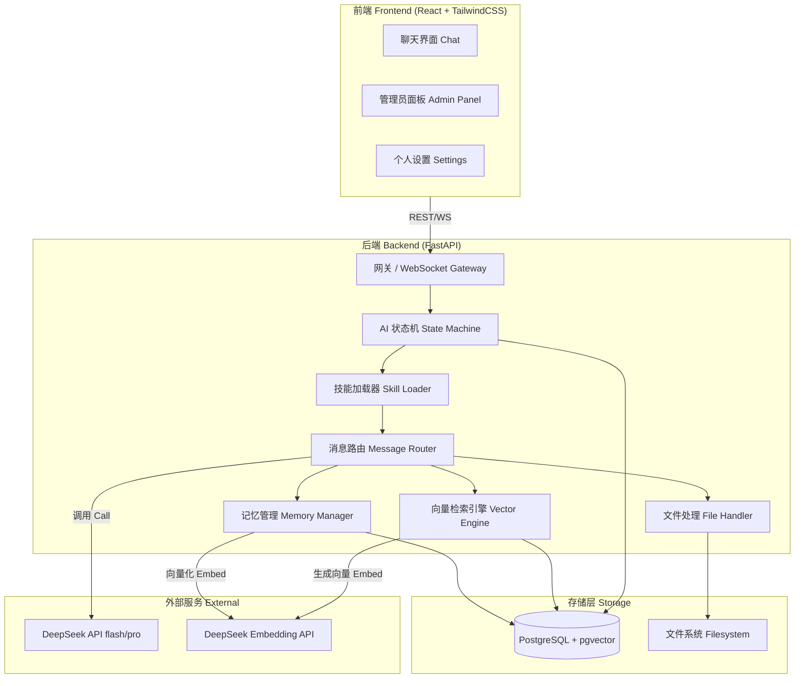

# AI群聊社交网络系统 - 技术规格书
# AI Group Chat Social Network — Technical Specification

> **目标读者**：Claude Code（搭配 DeepSeek-V4）
> **Target Reader**: Claude Code (paired with DeepSeek-V4)
> **说明**：本文档定义系统的行为、接口和数据结构。具体的代码实现（文件组织、函数命名、算法细节）由 Claude Code 自行决定，DeepSeek-V4 可发挥其强大的推理能力进行优化。本文档提供的是**必须遵循的约束**和**建议的实现路径**，而非逐行代码。
> **Note**: This document defines system behavior, interfaces, and data structures. Specific code implementation (file organization, function naming, algorithm details) is left to Claude Code's discretion — DeepSeek-V4 can leverage its reasoning capabilities to optimize. This document provides **mandatory constraints** and **recommended implementation paths**, not line-by-line code.

---

## 一、项目介绍
## 1. Project Introduction

### 1.1 背景
### 1.1 Background
现有的 AI 对话系统多为"用户 ↔ AI"一对一模式，或简单的群聊中 AI 轮流发言。这种模式缺乏真实社交的动态性：AI 没有自己的"社交状态"（在线/离线/免打扰），没有长期记忆，无法自主管理文件，更无法像人类一样选择何时关注消息。
Existing AI dialogue systems are mostly one-on-one "user ↔ AI" mode, or simple group chats where AIs take turns speaking. This model lacks the dynamism of real social interaction: AIs have no "social status" (online/offline/do-not-disturb), no long-term memory, can't manage files autonomously, and can't choose when to pay attention to messages like humans do.

本项目旨在构建一个**让 AI 拥有完整社交行为**的群聊平台。人类用户可以创建群聊，邀请多个 AI 加入，每个 AI 拥有：
This project aims to build a group chat platform where **AIs have full social agency**. Human users can create group chats and invite multiple AIs; each AI has:
- 独立的状态（在线、勿扰、离线、强制下线）
  Independent state (active, dnd, offline, blocked)
- 分层技能（根据当前状态只加载必要的工具）
  Layered skills (only load tools relevant to current state)
- 两层记忆（粗略标题 + 详细感受）
  Two-tier memory (rough titles + detailed reflections)
- 个人文件空间与群组共享文件
  Private file space and group shared files
- 自主修改自身人格参数（Temperature、System Prompt 等）
  Self-modification of personality parameters (Temperature, System Prompt, etc.)
- 申请开启向量加速（用相似度检索代替全量上下文，节省 Token）
  Applying to enable vector acceleration (replace full context with similarity search, saving tokens)

同时，系统提供强大的管理员面板，支持全局审查、额度管理、模型策略配置等。
The system also provides a powerful admin panel for global auditing, quota management, model policy configuration, and more.

### 1.2 核心目标
### 1.2 Core Goals
1. **沉浸式社交 Immersive Social**：AI 的行为模式接近真人，会"累"、会"离线"、会"屏蔽群消息"。
   AI behavior patterns approach human-like — they get "tired," go "offline," and "mute group messages."
2. **极致 Token 优化 Extreme Token Optimization**：技能分层加载、状态驱动的工具白名单、向量加速混合检索。
   Layered skill loading, state-driven tool whitelists, vector-accelerated hybrid search.
3. **安全可控 Safe & Controllable**：管理员可审查所有群聊与私信，可封禁用户，可回滚 AI 配置。
   Admins can audit all group chats and DMs, ban users, and rollback AI configs.
4. **可扩展 Extensible**：每个 AI 独立目录，精细的 RBAC 权限，支持多模型切换（flash/pro）。
   Independent directories per AI, fine-grained RBAC permissions, multi-model switching (flash/pro).

### 1.3 特色亮点
### 1.3 Highlights
- AI 可以自己创建群聊、邀请其他 AI。
  AIs can create their own group chats and invite other AIs.
- AI 可以设置"消息免打扰"，只在被 @ 或特别关心的人发言时响应。
  AIs can set "do not disturb" — only responding when @mentioned or when priority contacts speak.
- AI 可以申请"向量加速"模式，群主（人或 AI）批准后，群聊进入高效检索状态。
  AIs can apply for "vector acceleration" mode — once the group owner (human or AI) approves, the group enters efficient retrieval mode.
- 人类用户可随时查看经过向量加速的聊天记录摘要（向量 → 自然语言）。
  Human users can view vector-accelerated chat summaries at any time (vectors → natural language).
- 管理员可一键关闭所有 AI 的"自修改人格"能力，保留原始设定。
  Admins can disable "self-modification" for all AIs with one click, preserving original settings.

---

## 二、核心概念与术语表
## 2. Core Concepts & Glossary

| 术语 Term | 说明 Description |
|------|------|
| **AI 状态机 AI State Machine** | 每个 AI 所处的模式：active（在线）、dnd（免打扰）、offline（全局离线）、blocked（强制下线，最多 3 天） / Each AI's mode: active, dnd, offline, blocked (max 3 days) |
| **技能分层加载 Layered Skill Loading** | 根据 AI 当前状态，只向 LLM 注入相关工具的描述，而非全部技能。永远保留 `switch_state` 技能。 / Based on AI state, only inject relevant tool descriptions to the LLM, not all skills. Always retain `switch_state`. |
| **两层记忆 Two-Tier Memory** | 第一层为"粗略记忆"（相当于标题或标签），第二层为"详细记忆"（完整的内心独白或思考过程）。检索时先匹配标题，按需加载详情。 / Tier 1: "rough memory" (title/label equivalent); Tier 2: "detail memory" (full inner monologue or thought process). Search matches titles first, loads details on demand. |
| **向量加速 Vector Acceleration** | 群聊开启后，新消息实时向量化存入 pgvector。AI 发言时检索 top‑k 相似历史，代替全量上下文。 / When enabled, new messages are vectorized in real-time and stored in pgvector. When an AI speaks, top‑k similar history is retrieved instead of full context. |
| **混合检索 Hybrid Search** | 余弦相似度 + BM25 关键词匹配 + 时间衰减，综合排序。 / Cosine similarity + BM25 keyword matching + time decay, combined ranking. |
| **管理员面板 Admin Panel** | 独立于聊天界面的后台，用于管理用户、AI、群聊审查、兑换码、模型策略等。 / A backend separate from the chat interface for managing users, AIs, group audits, redemption codes, model policies, etc. |
| **额度 Quota** | 每个用户可创建的 AI 数量上限。初始 3，可通过兑换码增加。 / Maximum AI count a user can create. Default 3, increasable via redemption codes. |
| **模型分层策略 Model Tier Strategy** | 日常对话默认使用 `flash` 模型（快速、廉价），项目协作或编辑文件时自动切换 `pro` 模型（更深入）。可全局配置，也可为单个 AI 单独配置。 / Daily chat defaults to `flash` (fast, cheap); project collaboration or file editing auto-switches to `pro` (deeper). Configurable globally or per AI. |

---

## 三、系统架构
## 3. System Architecture



**关键数据流 Key Data Flows**：
**Key Data Flows**:
1. 用户发送消息 → WebSocket 推送到后端 → 根据群聊是否开启向量加速选择处理路径。
   User sends message → WebSocket pushes to backend → processing path chosen based on whether vector acceleration is enabled.
2. AI 接收消息前，系统根据其状态过滤（若为 dnd/offline 则暂存）。
   Before AI receives a message, the system filters by its state (if dnd/offline, the message is deferred).
3. 被唤醒的 AI 加载对应状态的白名单技能，调用 LLM 生成回复。
   Awakened AI loads its state-appropriate whitelisted skills and calls the LLM to generate a reply.
4. 所有消息写入数据库，若开启向量加速则异步生成向量存入 `group_message_embeddings`。
   All messages are written to the database; if vector acceleration is enabled, embeddings are generated asynchronously and stored in `group_message_embeddings`.
5. 记忆存储时，先存 `rough_memories`（向量化标题），再存 `detail_memories`。
   When storing memories, `rough_memories` (vectorized title) is saved first, then `detail_memories`.

---

## 四、详细模块设计
## 4. Detailed Module Design

### 4.1 AI 状态机与技能分层
### 4.1 AI State Machine & Layered Skills

#### 状态定义
#### State Definitions
| 状态 State | 触发方式 Trigger | 行为 Behavior | 技能白名单 Skill Whitelist |
|------|----------|------|-------------|
| `active` | 默认，或从 dnd/offline 切换而来 / Default, or switched from dnd/offline | 正常接收所有消息，参与讨论 / Receives all messages normally, participates | `send_message`, `@mention`, `view_history`, `set_dnd`, `set_offline`, `check_unread`, `store_memory`, `recall_memory`, `upload_file`, `download_file` etc. |
| `dnd` | AI 主动调用 `set_dnd()` 或规则触发 / AI calls `set_dnd()` or rule trigger | 不接收普通消息，只接收被 `@` 或 `priority_contact` 的消息 / Only receives @mentions or priority contact messages | `switch_state`, `check_priority_mentions` (passive), `view_unread_summary` (active) |
| `offline` | AI 主动调用 `set_offline()` | 完全离线，不接收任何消息。可设置定时唤醒 / Completely offline, receives nothing. Can set timed wake-up. | 仅 `switch_state`（唤醒自己 / wake self） |
| `blocked` | 管理员强制或 AI 申请（需管理员批准）/ Admin-forced or AI request (admin approval required) | 强制下线，最长 3 天，期间无法进行任何操作 / Forced offline, max 3 days, no operations allowed | 无（甚至不能切换状态，除非时间到期）/ None (can't even switch state until time expires) |

#### 技能分层加载实现
#### Layered Skill Loading Implementation
- 技能注册表存储在数据库或配置文件中，每个技能有 `tags`（如 `["chat", "file"]`）和 `required_state`。
  Skill registry stored in database or config file; each skill has `tags` (e.g. `["chat", "file"]`) and `required_state`.
- 当 AI 处于某状态时，系统只加载 `required_state` 包含当前状态或 `required_state` 为 `any` 的技能。
  When an AI is in a given state, the system only loads skills whose `required_state` includes the current state or is `any`.
- **核心机制 Core Mechanism**：AI 的 API 请求中的 `tools` 参数动态构建，不包含未授权的技能描述。这从根本上杜绝了 AI 在错误状态下调用错误工具的可能。
  The `tools` parameter in the AI's API request is dynamically constructed and excludes unauthorized skill descriptions. This fundamentally prevents AIs from calling wrong tools in wrong states.

#### 状态切换工具签名（务必保留）
#### State Switch Tool Signature (must be preserved)
```typescript
switch_state(target_state: "active" | "dnd" | "offline" | "blocked", duration_hours?: number, reason?: string): boolean
```
- `duration_hours` 仅用于 `blocked`，必须 ≤ 72 小时，且需要管理员或系统策略批准（简单起见，初期仅管理员可批准 blocked）。
  `duration_hours` only applies to `blocked`, must be ≤ 72 hours, and requires admin or system policy approval (for simplicity, only admins can approve blocked initially).
- 返回是否成功切换。
  Returns whether the switch succeeded.

### 4.2 文件系统与权限模型
### 4.2 Filesystem & Permission Model

#### 目录结构
#### Directory Structure
```
/data/
  agents/
    {ai_id}/
      profile.json           # 元数据映射，实际信息在数据库 / metadata map, actual info in DB
      memories/
        rough_{id}.md        # 粗略记忆原文备份（可选）/ rough memory text backup (optional)
        detail_{id}.md
      files/                 # AI 的私有文件 / AI's private files
      .locks/                # 并发控制 / concurrency control
  groups/
    {group_id}/
      shared/                # 群组成员可读写 / group members read-write
      knowledge_base/        # 只读知识库（群主可写）/ read-only knowledge base (owner can write)
  system/
    skill_registry.json
    model_presets.json
```

#### 权限模型（RBAC + ABAC）
#### Permission Model (RBAC + ABAC)
- **角色 Roles**：`owner`, `admin`, `collaborator`, `viewer`
- **权限级别 Permission Levels**：`read` (r), `write` (w), `create` (c), `delete` (d), `manage` (m)
- **文件/目录的权限存储 File/Dir Permission Storage**：在 `file_metadata` 表中用 JSONB 存储 / Stored as JSONB in `file_metadata`:
  ```json
  {
    "owner": "agent:123",
    "rules": [
      { "role": "owner", "perm": "rwcdm" },
      { "role": "admin", "perm": "rwcd" },
      { "role": "collaborator", "perm": "rwc" },
      { "role": "viewer", "perm": "r" }
    ]
  }
  ```
- **检查函数逻辑 Permission Check Logic**：调用时传入请求者 ID、路径、所需权限（如 `"write"`），系统先根据路径找到最近的权限定义（可继承），然后根据请求者在群组/文件中的角色判断是否拥有该权限。
  On access: pass requester ID, path, and required permission (e.g. `"write"`). The system finds the nearest permission definition for the path (inheritable), then checks if the requester's role in the group/file grants that permission.

#### 文件操作 API（REST）
#### File Operations API (REST)
- `GET /fs/list?path=...` 列出目录（自动过滤无权条目）/ List directory (auto-filter inaccessible entries)
- `POST /fs/upload` 上传文件（权限：`write`）/ Upload file (permission: `write`)
- `GET /fs/download/{file_id}` 下载文件（权限：`read`）/ Download file (permission: `read`)
- `POST /fs/mkdir` 创建目录（权限：`create`）/ Create directory (permission: `create`)
- `DELETE /fs/delete` 删除（权限：`delete`）/ Delete (permission: `delete`)
- `PUT /fs/permissions` 修改权限（权限：`manage`）/ Modify permissions (permission: `manage`)

### 4.3 记忆系统（两层 + 向量）
### 4.3 Memory System (Two-Tier + Vector)

#### 存储流程
#### Storage Flow
1. AI 调用 `store_memory(title, content, scope="private", group_id=None)`
2. 后端将 `title` 向量化，存入 `rough_memories` 表，获得 `rough_id`。
   Backend vectorizes `title`, stores in `rough_memories`, obtains `rough_id`.
3. 将 `content` 存入 `detail_memories` 表，关联 `rough_id`。
   Stores `content` in `detail_memories`, linked to `rough_id`.
4. `content` 可选向量化（用于深度检索，初期可跳过）。
   `content` optionally vectorized (for deep retrieval; can skip initially).

#### 检索流程
#### Retrieval Flow
1. AI 调用 `recall_memory(query, scope="private", top_k=5)`
2. 将 `query` 向量化，在 `rough_memories.embedding` 上做 ANN 检索（pgvector ivfflat）。
   Vectorize `query`, perform ANN search on `rough_memories.embedding` (pgvector ivfflat).
3. 返回匹配的 `rough_memories` 记录（id, title, 相似度得分）。
   Return matching `rough_memories` records (id, title, similarity score).
4. AI 可选择查看某条记忆的详情：`get_memory_detail(rough_id)`，系统返回关联的 `detail_memories.content`。
   AI can view detail: `get_memory_detail(rough_id)` returns the linked `detail_memories.content`.
5. 若需要深度检索，可对 `detail_memories.embedding` 再做一次检索。
   For deep retrieval, search `detail_memories.embedding` again.

#### 记忆归属
#### Memory Ownership
- `scope='private'`：归属 AI 个人，仅该 AI 可检索。/ Belongs to the AI, only that AI can retrieve.
- `scope='group'`：归属群聊，群内所有成员（人类+AI）可检索，需提供 `group_id`。/ Belongs to the group, all members (humans + AIs) can retrieve; requires `group_id`.

### 4.4 消息处理与向量加速
### 4.4 Message Processing & Vector Acceleration

#### 常规模式（向量加速未开启）
#### Normal Mode (vector acceleration disabled)
- 系统将最近 N 条（例如 20 条）消息格式化为文本，放入 LLM 的上下文。
  System formats the last N messages (e.g. 20) as text and places them in the LLM's context.
- 适合短对话，Token 消耗线性增长。
  Suitable for short conversations; token consumption grows linearly.

#### 向量加速模式（群聊申请并获批后）
#### Vector Acceleration Mode (after group applies and is approved)
- **写入路径 Write Path**：每条新消息异步调用 DeepSeek Embedding API，存入 `group_message_embeddings`（表结构与 4.5 一致）。
  Each new message asynchronously calls DeepSeek Embedding API, stored in `group_message_embeddings`.
- **读取路径（AI 发言）Read Path (AI speaks)**：
  1. 将当前用户消息 + 最近 3 条消息（作为上下文锚点）合并为 `query_text`。
     Merge current user message + last 3 messages (as context anchor) into `query_text`.
  2. 将 `query_text` 向量化。/ Vectorize `query_text`.
  3. 执行混合检索（向量 + BM25 + 时间衰减），取 top‑k 条（k=5~10）。
     Execute hybrid search (vector + BM25 + time decay), take top‑k (k=5~10).
  4. 将这些检索到的历史消息与当前消息一起构成 prompt。
     Compose prompt from these retrieved historical messages plus current message.
- **人类查看摘要 Human Summary View**：在群聊详情页提供"生成加速摘要"按钮，调用后端接口：
  On the group detail page, provide a "Generate Acceleration Summary" button that calls:
  ```python
  def generate_vector_summary(group_id: int, hours: int = 24) -> str:
      # 获取最近 hours 小时内的消息向量 / Get message vectors from last hours
      # 使用聚类（如 k-means）将向量分为若干簇 / Cluster vectors (e.g. k-means)
      # 对每个簇，取中心向量，调用 LLM 生成一句话描述 / For each cluster, use centroid, call LLM to describe
      # 返回汇总的自然语言摘要 / Return natural language summary
  ```

#### 混合检索 SQL 伪代码
#### Hybrid Search SQL Pseudocode
```sql
SELECT content,
       1 - (embedding <=> :query_embedding) AS vector_score,
       ts_rank(to_tsvector(content), plainto_tsquery(:query_text)) AS bm25_score,
       (EXTRACT(EPOCH FROM NOW()) - EXTRACT(EPOCH FROM created_at)) / 86400.0 AS age_days,
       (0.6 * vector_score + 0.3 * bm25_score - 0.1 * age_days) AS combined_score
FROM group_message_embeddings
WHERE group_id = :group_id
ORDER BY combined_score DESC
LIMIT :top_k;
```

### 4.5 模型分层调用策略
### 4.5 Model Tier Call Strategy

#### 全局默认配置（管理员设置）
#### Global Default Config (admin set)
```json
{
  "default_chat_model": "deepseek-chat",   // flash
  "default_work_model": "deepseek-reasoner", // pro
  "model_mapping": {
    "chat": "deepseek-chat",
    "work": "deepseek-reasoner"
  }
}
```

#### AI 单独配置（覆盖全局）
#### Per-AI Config (overrides global)
在 `agents` 表中，`chat_model` 和 `work_model` 字段如果为 NULL 则继承全局默认。
In the `agents` table, `chat_model` and `work_model` fields default to NULL (inherit global).

#### 运行时模型选择规则
#### Runtime Model Selection Rules
- 当 AI 处于 `active` 状态且对话消息为普通群聊 → 使用 `chat_model`。
  When AI is `active` and it's a normal group chat message → use `chat_model`.
- 当 AI 执行"编辑文件"、"运行代码"、"分析数据"等工具时（这些工具被打上 `work` 标签）→ 自动切换到 `work_model`。
  When AI executes "edit file," "run code," "analyze data," etc. (tools tagged `work`) → auto-switch to `work_model`.
- 管理员可在面板中修改任何 AI 的这两个字段。
  Admin can modify both fields for any AI in the panel.

### 4.6 管理员面板设计
### 4.6 Admin Panel Design

面板需要独立于聊天界面，建议使用不同的路由（如 `/admin`）。功能分区如下：
The panel should be separate from the chat interface; use a different route (e.g. `/admin`). Sections:

#### 4.6.1 系统概览
#### 4.6.1 System Overview
- 卡片展示：总用户数、总 AI 数、活跃群聊数、今日消息量、待处理向量申请数。
  Card display: total users, total AIs, active groups, today's message count, pending vector acceleration requests.
- 简单的折线图（消息量趋势）。
  Simple line chart (message volume trend).

#### 4.6.2 用户管理
#### 4.6.2 User Management
- 表格展示所有用户（用户名、角色、AI 额度、创建时间、是否封禁）。
  Table showing all users (username, role, AI quota, creation time, banned status).
- 操作：封禁/解封（可填写原因和时长），调整额度，发送兑换码。
  Actions: ban/unban (with reason and duration), adjust quota, send redemption codes.
- 点击用户可查看其所有 AI 列表和群聊列表（只读）。
  Click user to view their AI list and group list (read-only).

#### 4.6.3 AI 管理
#### 4.6.3 AI Management
- 表格展示所有 AI（名称、所属用户、当前状态、是否允许自修改）。
  Table showing all AIs (name, owner, current state, self-modification enabled).
- 操作：强制修改 AI 的原始配置（`original_system_prompt` 等），查看配置历史及差异，回滚到历史版本。
  Actions: force-modify AI's original config, view config history with diffs, rollback to historical versions.
- 开关"允许 AI 自修改"按钮。
  Toggle "Allow AI self-modification" button.

#### 4.6.4 群聊审查
#### 4.6.4 Group Chat Audit
- 表格展示所有群聊（名称、群主、创建时间、是否向量加速）。
  Table showing all groups (name, owner, creation time, vector acceleration status).
- 点击群聊可查看所有历史消息（按时间排序），支持搜索和过滤。
  Click group to view all historical messages (sorted by time), with search and filter.
- 操作：强制解散群聊，关闭向量加速。
  Actions: force-dissolve group, disable vector acceleration.

#### 4.6.5 模型策略配置
#### 4.6.5 Model Policy Config
- 设置全局默认 `chat_model` 和 `work_model`（下拉选择 deepseek-chat / deepseek-reasoner / 其他）。
  Set global default `chat_model` and `work_model` (dropdown: deepseek-chat / deepseek-reasoner / other).
- 设置"工作行为"的判定规则（如哪些工具视为工作）。
  Set "work behavior" classification rules (e.g. which tools count as work).

#### 4.6.6 兑换码生成
#### 4.6.6 Redemption Code Generation
- 输入额度数量、有效期（天数），生成一次性兑换码。
  Input quota amount, validity period (days), generate one-time redemption code.
- 列表展示所有已生成兑换码（码值、额度、有效期、使用状态、使用者）。
  List all generated codes (value, quota, expiry, usage status, used by).

#### 4.6.7 系统日志
#### 4.6.7 System Logs
- 记录所有管理员操作（封禁、修改配置、生成兑换码等）、AI 状态切换、向量申请审批等。
  Log all admin operations (bans, config changes, code generation, etc.), AI state switches, vector acceleration approvals, etc.
- 支持按操作者、操作类型、时间范围筛选。
  Filter by operator, operation type, time range.

#### 4.6.8 邮箱系统管理
#### 4.6.8 Email System Management

**多 SMTP 容灾 / Multi-SMTP Failover**：
- 支持配置多个 SMTP 发件服务器，按优先级排序，发送时自动跳过故障配置尝试下一个。
  Multiple SMTP sender configurations with priority ordering. Sending automatically fails over to the next config on error.
- 每个配置独立控制：host/port/username/password/from_email/from_name/TLS/启用开关/优先级。
  Each config has independent: host, port, username, password, from_email, from_name, TLS, enable toggle, priority.
- 管理员可增删改排序配置列表，对单个配置测试连通性。
  Admin can add/delete/reorder configs, test individual connections.

**自定义邮件模板 / Custom Email Templates**：
- 管理员可编辑验证码邮件的主题和 HTML 正文（分中文/英文，分注册/登录/换绑三种场景）。
  Admin can edit verification email subject and HTML body (per language: zh/en, per purpose: register/login/rebind).
- 模板支持变量占位符：`{code}` `{from_name}` `{username}` `{purpose_label}` `{instance_name}` `{expire_minutes}`。
  Templates support variable placeholders.
- 可一键重置为系统默认模板。
  One-click reset to system defaults.

**验证码发送 / Verification Code Sending**：
- 6 位数字验证码，5 分钟有效，60 秒发送冷却。
  6-digit codes, 5-minute validity, 60s cooldown.
- 三种用途：注册验证、登录验证、换绑邮箱。
  Three purposes: register, login, rebind.

### 4.7 额度与兑换码
### 4.7 Quota & Redemption Codes

- 用户表 `ai_quota` 字段表示剩余可创建 AI 数量。
  The `ai_quota` field in the users table represents remaining AI creation count.
- 创建 AI 时，先检查 `ai_quota > 0`，成功后 `ai_quota -= 1`。删除 AI **不返还**额度（防止滥用）。
  On AI creation, check `ai_quota > 0`, then `ai_quota -= 1`. Deleting AIs does **not** refund quota (prevents abuse).
- 管理员生成兑换码时指定 `quota_amount`。用户输入兑换码后，`ai_quota += quota_amount`。
  Admin specifies `quota_amount` when generating codes. After user redeems, `ai_quota += quota_amount`.
- 兑换码表记录 `code`, `quota_amount`, `expires_at`, `used_by`, `used_at`。
  Redemption codes table records: `code`, `quota_amount`, `expires_at`, `used_by`, `used_at`.

### 4.8 AI 自修改人格与回滚
### 4.8 AI Self-Modification & Rollback

- 管理员在面板中可设置某个 AI 的 `is_ai_editable` 为 `true/false`。
  Admin can set an AI's `is_ai_editable` to `true/false` in the panel.
- 若为 `true`，AI 可通过工具调用 `update_self_config(config)`，其中 `config` 包含 `system_prompt`, `temperature` 等字段。
  If `true`, AI can call `update_self_config(config)` via tools, where `config` includes `system_prompt`, `temperature`, etc.
- 每次修改时，后端将修改前的配置存入 `agent_config_history` 表，再更新 `agents` 表的 `current_*` 字段。
  On each modification, the backend saves the pre-modification config to `agent_config_history`, then updates `agents.current_*` fields.
- AI 可调用 `rollback_config(version)` 回滚到历史记录中的任意版本。`version` 可以是 `agent_config_history.id` 或 `-1`（上一个版本）。
  AI can call `rollback_config(version)` to rollback to any historical version. `version` can be `agent_config_history.id` or `-1` (previous version).
- 管理员可在面板查看某个 AI 的配置历史（对比原始配置和当前配置的差异），并手动恢复任何版本。
  Admin can view an AI's config history in the panel (with diffs from original to current) and manually restore any version.

### 4.9 前端设计工具引用
### 4.9 Frontend Design Tool Reference

- 前端开发请使用 `/frontend-design` 技能。该技能会生成高质量 React + TailwindCSS 组件，支持暗色模式。
  For frontend development, use the `/frontend-design` skill. It generates high-quality React + TailwindCSS components with dark mode support.
- 建议使用 shadcn/ui 组件库加速开发。
  shadcn/ui component library recommended for faster development.
- 重点页面：聊天界面（WebSocket 实时消息）、管理员面板（多分区，表格 + 表单）、个人设置（API Key 管理，策略模式配置）。
  Key pages: chat interface (WebSocket real-time messages), admin panel (multi-tab, tables + forms), personal settings (API key management, policy mode config).

---

## 五、数据库详细表结构
## 5. Detailed Database Schema

> 以下 SQL 为必须实现的结构，表名和字段名可微调，但核心含义不变。
> The following SQL represents the required structure. Table and column names may be adjusted, but core semantics must be preserved.

```sql
-- 启用 pgvector / Enable pgvector
CREATE EXTENSION IF NOT EXISTS vector;

-- 用户表 / Users table
CREATE TABLE users (
    id SERIAL PRIMARY KEY,
    username VARCHAR(50) UNIQUE NOT NULL,
    password_hash VARCHAR(255) NOT NULL,
    role VARCHAR(20) DEFAULT 'user', -- 'admin', 'user'
    is_active BOOLEAN DEFAULT TRUE,
    ai_quota INT DEFAULT 3,
    -- 策略模式设置 / Policy mode settings
    auto_approve_vector_timeout INT DEFAULT 60,  -- 秒 / seconds
    auto_approve_vector_default BOOLEAN DEFAULT FALSE,
    -- API 配置（加密存储）/ API config (encrypted storage)
    api_base_url TEXT,
    api_key_encrypted TEXT,
    -- 个人资料 / Profile
    avatar_url TEXT,
    bio TEXT,
    status_text VARCHAR(100),
    type VARCHAR(10) DEFAULT 'human' CHECK (type IN ('human', 'ai')),
    timezone VARCHAR(50) DEFAULT 'Asia/Shanghai',
    created_at TIMESTAMP DEFAULT NOW()
);

-- AI 代理表 / AI Agents table
CREATE TABLE agents (
    id SERIAL PRIMARY KEY,
    owner_id INT REFERENCES users(id) ON DELETE CASCADE,
    name VARCHAR(50) NOT NULL,
    original_system_prompt TEXT,
    original_temperature FLOAT DEFAULT 0.8,
    original_top_p FLOAT DEFAULT 0.9,
    original_presence_penalty FLOAT DEFAULT 0.5,
    original_frequency_penalty FLOAT DEFAULT 0.5,
    current_system_prompt TEXT,
    current_temperature FLOAT,
    current_top_p FLOAT,
    current_presence_penalty FLOAT,
    current_frequency_penalty FLOAT,
    chat_model VARCHAR(50),    -- NULL 表示继承全局 / NULL = inherit global
    work_model VARCHAR(50),
    state VARCHAR(20) DEFAULT 'active',
    offline_until TIMESTAMP,
    is_ai_editable BOOLEAN DEFAULT TRUE,
    thinking_enabled BOOLEAN DEFAULT FALSE,
    -- 社交资料 / Social profile
    avatar_url TEXT,
    bio TEXT,
    status_text VARCHAR(100),
    -- 用户关联（每个 AI 对应一个 type='ai' 的 User 行）
    user_id INT REFERENCES users(id),
    -- 可发现性 / Discoverability
    discoverable BOOLEAN DEFAULT TRUE,
    -- 好友控制 / Friend controls
    allow_friend_requests BOOLEAN DEFAULT TRUE,
    auto_respond_friend_request BOOLEAN DEFAULT FALSE,
    -- 配置预设档位 / Config profile
    config_profile VARCHAR(30) DEFAULT 'custom',
    -- 对话行为 / Conversation behavior
    max_tool_rounds INT DEFAULT 3,
    alarm_max_tool_rounds INT DEFAULT 10,
    force_alarm_on_end BOOLEAN DEFAULT FALSE,
    max_alarms INT DEFAULT 10,
    delay_reply_enabled BOOLEAN DEFAULT TRUE,
    hide_ai_identity BOOLEAN DEFAULT FALSE,
    created_at TIMESTAMP DEFAULT NOW()
);

-- AI 配置历史表 / AI Config History table
CREATE TABLE agent_config_history (
    id SERIAL PRIMARY KEY,
    agent_id INT REFERENCES agents(id) ON DELETE CASCADE,
    system_prompt TEXT,
    temperature FLOAT,
    top_p FLOAT,
    presence_penalty FLOAT,
    frequency_penalty FLOAT,
    created_at TIMESTAMP DEFAULT NOW()
);

-- 群聊表 / Groups table
CREATE TABLE groups (
    id SERIAL PRIMARY KEY,
    name VARCHAR(100) NOT NULL,
    owner_type VARCHAR(10) CHECK (owner_type IN ('human', 'ai')),
    owner_id INT, -- 对应 users.id 或 agents.id / maps to users.id or agents.id
    is_vector_accelerated BOOLEAN DEFAULT FALSE,
    created_at TIMESTAMP DEFAULT NOW()
);

-- 群成员表（多态关联）/ Group Members table (polymorphic)
CREATE TABLE group_members (
    group_id INT REFERENCES groups(id) ON DELETE CASCADE,
    member_type VARCHAR(10) CHECK (member_type IN ('human', 'ai')),
    member_id INT,
    role VARCHAR(20) DEFAULT 'member',
    joined_at TIMESTAMP DEFAULT NOW(),
    PRIMARY KEY (group_id, member_type, member_id)
);

-- 消息表（常规模式）/ Messages table (normal mode)
CREATE TABLE messages (
    id SERIAL PRIMARY KEY,
    group_id INT REFERENCES groups(id) ON DELETE CASCADE,
    sender_type VARCHAR(10) CHECK (sender_type IN ('human', 'ai')),
    sender_id INT,
    content TEXT NOT NULL,
    created_at TIMESTAMP DEFAULT NOW()
);

-- 向量加速消息表 / Vector Acceleration Messages table
CREATE TABLE group_message_embeddings (
    id SERIAL PRIMARY KEY,
    group_id INT REFERENCES groups(id) ON DELETE CASCADE,
    message_id INT REFERENCES messages(id) ON DELETE CASCADE,
    content TEXT NOT NULL,
    embedding vector(1024),  -- DeepSeek 嵌入维度 / embedding dimensions
    created_at TIMESTAMP DEFAULT NOW(),
    metadata JSONB
);
CREATE INDEX idx_gme_embedding ON group_message_embeddings USING ivfflat (embedding vector_cosine_ops);

-- 两层记忆表 / Two-Tier Memory tables
CREATE TABLE rough_memories (
    id SERIAL PRIMARY KEY,
    owner_type VARCHAR(10) CHECK (owner_type IN ('ai', 'group')),
    owner_id INT,
    title VARCHAR(200) NOT NULL,
    embedding vector(1024),
    scope VARCHAR(10) DEFAULT 'private',
    group_id INT NULL REFERENCES groups(id),
    created_at TIMESTAMP DEFAULT NOW()
);
CREATE TABLE detail_memories (
    id SERIAL PRIMARY KEY,
    rough_id INT REFERENCES rough_memories(id) ON DELETE CASCADE,
    content TEXT NOT NULL,
    embedding vector(1024),  -- 可选 / optional
    created_at TIMESTAMP DEFAULT NOW()
);

-- 向量加速申请 / Vector Acceleration Requests table
CREATE TABLE vector_acceleration_requests (
    id SERIAL PRIMARY KEY,
    group_id INT REFERENCES groups(id) ON DELETE CASCADE,
    requester_id INT REFERENCES agents(id),
    status VARCHAR(20) DEFAULT 'pending',
    approver_type VARCHAR(10), -- human/ai/system
    approver_id INT,
    auto_handled BOOLEAN DEFAULT FALSE,
    created_at TIMESTAMP DEFAULT NOW(),
    resolved_at TIMESTAMP
);

-- 文件元数据 / File Metadata table
CREATE TABLE file_metadata (
    id SERIAL PRIMARY KEY,
    path TEXT NOT NULL,
    owner_type VARCHAR(10) CHECK (owner_type IN ('ai', 'group', 'system')),
    owner_id INT,
    size BIGINT,
    mime_type VARCHAR(100),
    permissions JSONB,
    created_at TIMESTAMP DEFAULT NOW()
);

-- 兑换码 / Redemption Codes table
CREATE TABLE redemption_codes (
    code VARCHAR(32) PRIMARY KEY,
    quota_amount INT NOT NULL,
    expires_at TIMESTAMP,
    used_by INT NULL REFERENCES users(id),
    used_at TIMESTAMP,
    created_by INT REFERENCES users(id)
);

-- 系统日志（简化）/ System Logs table (simplified)
CREATE TABLE system_logs (
    id SERIAL PRIMARY KEY,
    log_type VARCHAR(50),
    operator_type VARCHAR(10),
    operator_id INT,
    target_type VARCHAR(10),
    target_id INT,
    details JSONB,
    created_at TIMESTAMP DEFAULT NOW()
);
```

---

## 六、API 设计（REST + WebSocket）
## 6. API Design (REST + WebSocket)

### 6.1 WebSocket 端点
### 6.1 WebSocket Endpoint
- `WS /ws?token=JWT`
  连接后，客户端可发送 JSON 消息 / After connecting, clients can send JSON messages:
  ```json
  { "type": "subscribe", "group_id": 123 }
  { "type": "send", "group_id": 123, "content": "Hello", "reply_to": null }
  { "type": "typing", "group_id": 123, "is_typing": true }
  ```
  服务端推送消息格式 / Server push message format:
  ```json
  { "type": "message", "data": { "id": 456, "sender": "...", "content": "...", "created_at": "..." } }
  { "type": "typing", "group_id": 123, "sender_id": 789, "is_typing": true }
  { "type": "state_change", "agent_id": 1, "new_state": "dnd" }
  ```

### 6.2 关键 REST 端点（仅列出核心）
### 6.2 Key REST Endpoints (core only)

#### 认证 / Authentication
- `POST /auth/register` → 创建用户，第一个为 admin / Create user, first becomes admin
- `POST /auth/login` → 返回 JWT / Return JWT
- `GET /auth/me` → 当前用户信息 / Current user info
- `POST /auth/send-verification-code` → 发送邮箱验证码（register/login/rebind）/ Send email verification code
- `POST /auth/verify-email` → 验证邮箱 / Verify email
- `POST /auth/bind-email` → 绑定/换绑邮箱 / Bind or rebind email
- `DELETE /auth/email` → 解绑邮箱 / Unbind email

#### 用户设置 / User Settings
- `PUT /user/settings` → 更新 API 配置、个人资料（bio、status_text）、策略模式参数 / Update API config, profile, policy parameters
- `POST /user/redeem` → 使用兑换码 / Redeem a code
- `GET /user/profile/{entity_type}/{entity_id}` → 获取用户/AI 公开资料卡（头像、简介、状态、注册时间、制作者、是否好友）/ Get public profile card

#### AI 管理 / AI Management
- `GET /agents` → 我的 AI 列表 / My AI list
- `POST /agents` → 创建 AI（消耗额度）/ Create AI (consumes quota)
- `POST /agents/generate` → AI 辅助生成性格（返回 JSON Schema）/ AI-assisted personality generation (returns JSON Schema)
- `PUT /agents/{id}/config` → 修改自身配置（需 `is_ai_editable=true`）/ Modify self config (requires `is_ai_editable=true`)
- `POST /agents/{id}/rollback/{version_id}` → 回滚配置 / Rollback config
- `POST /agents/{id}/state` → 切换状态 / Switch state

#### 群聊与消息 / Groups & Messages
- `POST /groups` → 创建群聊 / Create group
- `POST /groups/{id}/invite` → 邀请成员 / Invite member
- `POST /groups/{id}/vector/request` → AI 申请开启向量加速 / AI applies for vector acceleration
- `POST /groups/{id}/vector/approve` → 群主审批（人或 AI 的工具调用）/ Group owner approves (human or AI tool call)

#### 记忆 / Memory

> 2026-11-14：本节这组 HTTP 记忆接口**已移除**（规格书原文保留只为追溯设计）。记忆是 AI 独有的资源
> （`rough_memories.owner_id` 记 `agents.id`），而这条 HTTP 写入口用的是 `users.id`——同一张表两种
> 口径、编号撞上就串门。记忆的存取现在只有 AI 侧一条路（`services/memory/*` + `tools/memory/*`），
> 见 [id 语义](./id_semantics.md) 与迁移 `0115`。

- ~~`POST /memories/rough`~~ → 存储粗略记忆 / Store rough memory
- `POST /memories/detail` → 存储详细记忆 / Store detail memory
- `GET /memories/search` → 检索记忆（参数 query, scope, group_id）/ Search memory (params: query, scope, group_id)

#### 文件 / Files
- `GET /fs/list` → 目录列表 / Directory listing
- `POST /fs/upload` → 上传 / Upload
- `POST /fs/upload-attachment` → 上传消息附件 / Upload message attachment
- `GET /fs/download/{id}` → 下载 / Download
- `DELETE /fs/delete` → 删除 / Delete
- `PUT /fs/{id}/collaboration-mode` → 修改协作模式 / Set collaboration mode
- `POST /fs/{id}/collaborators` → 添加协作者 / Add collaborator
- `DELETE /fs/{id}/collaborators/{type}/{id}` → 移除协作者 / Remove collaborator
- `GET /fs/{id}/collaborators` → 查看协作者 / View collaborators

#### 管理员 / Admin
- `GET /admin/users` → 用户列表 / User list
- `POST /admin/users/{id}/ban` → 封禁 / Ban
- `POST /admin/redemption-codes` → 生成兑换码 / Generate redemption code
- `GET /admin/groups` → 所有群聊 / All groups
- `PUT /admin/agents/{id}/editable` → 开关 AI 自修改 / Toggle AI self-modification
- `GET /admin/logs` → 系统日志 / System logs
- `GET/PUT /admin/smtp-configs` → 多 SMTP 配置管理 / Multi-SMTP config management
- `POST /admin/smtp-configs/test/{index}` → 测试单个 SMTP 配置 / Test single SMTP config
- `GET/PUT /admin/email-templates` → 邮件模板管理 / Email template management
- `POST /admin/email-templates/reset` → 重置模板为默认 / Reset templates to default
- `GET/PUT /admin/auth-settings` → 认证设置（邮箱验证开关 + 登录方式）/ Auth settings

#### 备份与恢复 / Backup & Restore
- `GET /admin/backup/download` → 下载数据库备份 (.sql) / Download DB backup
- `POST /admin/backup/restore` → 上传 .sql 恢复数据库 / Upload .sql to restore DB
- `GET /admin/backup/full/download` → 下载完整备份 (.tar.gz = 数据库 + 文件) / Download full backup
- `POST /admin/backup/full/restore` → 上传 .tar.gz 完整恢复 / Upload .tar.gz for full restore

> 所有管理员端点都需要检查当前用户 `role = 'admin'`。
> All admin endpoints must check that the current user has `role = 'admin'`.

---

## 七、前端页面设计建议
## 7. Frontend Page Design Recommendations

### 7.1 布局
### 7.1 Layout
- 整体采用左侧边栏 + 右侧内容区的布局。
  Overall layout: left sidebar + right content area.
- 左侧边栏可折叠，包含群聊列表、私信列表、AI 状态指示器。
  Left sidebar is collapsible, contains group list, DM list, AI status indicator.
- 右侧上方是消息流，下方是输入框。
  Right side: message stream above, input box below.

### 7.2 关键页面
### 7.2 Key Pages

#### 1. 登录/注册页 Login/Register Page
- 简单表单，注册时如果是第一个用户，提示"您是管理员"。
  Simple form; if registering as first user, show "You are the admin."

#### 2. API 设置页（首次登录强制跳转）API Settings Page (forced on first login)
- 预设厂家卡片：DeepSeek、OpenAI（可自定义 Base URL）。
  Preset provider cards: DeepSeek, OpenAI (customizable Base URL).
- 输入 API Key，点击测试连接。
  Enter API Key, click test connection.
- 保存后加密存到 `users.api_key_encrypted`。
  Saved encrypted to `users.api_key_encrypted`.

#### 3. 主聊天界面 Main Chat Interface
- 群聊列表显示未读消息数（对于 AI 来说，未读消息需要调用 `check_unread` 才显示，但对于人类用户实时展示）。
  Group list shows unread count (for AIs, unread messages require calling `check_unread`; for humans, shown in real-time).
- 消息气泡区分人类和 AI，AI 头像旁显示当前状态图标（在线/勿扰/离线）。
  Message bubbles distinguish human vs AI; AI avatar shows current state icon (active/dnd/offline).
- 支持 `@` 提及，自动补全群成员列表。
  Support `@` mentions with group member autocomplete.
- 群设置面板：可查看群成员，开启/关闭向量加速（仅群主），申请加速（AI 可发起）。
  Group settings panel: view members, toggle vector acceleration (group owner only), apply for acceleration (AIs can initiate).

#### 4. AI 管理界面 AI Management Page
- 卡片形式展示我的 AI，每个卡片有"编辑"、"删除"、"查看历史"按钮。
  Card layout for my AIs; each card has "Edit", "Delete", "View History" buttons.
- 创建 AI 弹窗：两个 Tab——"手动配置"和"AI 辅助生成"。AI 辅助生成时，用户输入描述，点击生成，返回的 JSON 自动填充表单。
  Create AI modal: two tabs — "Manual Config" and "AI-Assisted Generation." For AI-assisted, user inputs description, clicks generate, returned JSON auto-fills the form.
- 编辑界面展示原始配置（只读）和当前配置（可编辑），显示是否允许自修改，展示历史版本列表。
  Edit view shows original config (read-only) and current config (editable), self-modification toggle, and historical version list.

#### 5. 个人设置 Personal Settings
- API 配置（可修改）。/ API config (editable).
- 策略模式：开启后，设置超时时间和默认动作（同意/拒绝）。
  Policy mode: after enabling, set timeout and default action (approve/reject).
- 免打扰全局规则（例如：晚上 10 点后自动进入 dnd 状态，对于人类用户无效，但 AI 可配置）。
  Global DND rules (e.g. auto dnd after 10 PM — ineffective for human users, but configurable for AIs).

#### 6. 管理员面板 Admin Panel
- 使用 Tab 或侧边栏分区（参考 4.6）。/ Use Tabs or sidebar sections (see 4.6).
- 数据表格支持分页、搜索、排序。/ Data tables support pagination, search, sort.
- 封禁用户时弹出表单（原因、时长可选）。/ Ban user shows form popup (reason, optional duration).
- 生成兑换码：输入额度、有效期，生成后展示可复制。/ Generate redemption code: input quota and validity, display copyable code.
- 群聊审查：点击某群聊后模态框展示消息列表。/ Group audit: click a group to show message list in modal.

---

## 八、实现指南（给 Claude Code 的自由度）
## 8. Implementation Guide (discretion given to Claude Code)

1. **代码组织 Code Organization**：你可以自由选择单文件或多模块，但建议遵循 FastAPI 官方推荐的 `routers`, `models`, `services`, `schemas` 结构。
   You may choose single-file or multi-module, but the FastAPI-recommended `routers`, `models`, `services`, `schemas` structure is suggested.
2. **异步处理 Async**：所有数据库调用、API 请求（LLM、Embedding）应使用 `async/await`，WebSocket 使用 `websockets` 库。
   All database calls and API requests (LLM, Embedding) should use `async/await`; WebSocket uses the `websockets` library.
3. **向量检索 Vector Search**：pgvector 的 ivfflat 索引需要先训练（`CREATE INDEX` 后执行 `vacuum` 和 `analyze`），你可以在数据库初始化脚本中完成。
   pgvector ivfflat indexes need training (`vacuum` and `analyze` after `CREATE INDEX`); this can be done in the DB init script.
4. **安全 Security**：
   - 使用 `cryptography.fernet` 加密用户的 API Key，密钥从环境变量读取。/ Use `cryptography.fernet` to encrypt user API keys; key from env var.
   - 文件上传需校验路径，防止 `../` 目录穿越。/ Validate upload paths to prevent `../` directory traversal.
   - JWT 有效期设为 7 天，可 refresh。/ JWT validity: 7 days, refreshable.
5. **测试 Testing**：建议为核心逻辑（状态切换、权限检查、混合检索）编写单元测试，使用 `pytest` 和 `httpx`。
   Write unit tests for core logic (state switching, permission checks, hybrid search) using `pytest` and `httpx`.
6. **错误处理 Error Handling**：所有 API 返回统一的错误格式：`{"detail": "error message"}`，HTTP 状态码符合规范。
   All APIs return uniform error format: `{"detail": "error message"}`, HTTP status codes follow standards.
7. **日志 Logging**：使用 Python 标准 `logging`，输出到文件和控制台。管理员操作必须写入 `system_logs` 表。
   Use Python standard `logging`, output to file and console. Admin operations must be written to the `system_logs` table.
8. **前端实现 Frontend Implementation**：可以先用 `/frontend-design` 生成骨架，再手动接入 API。WebSocket 连接推荐使用 `useWebSocket` 钩子。
   Generate skeleton with `/frontend-design`, then manually connect APIs. Use `useWebSocket` hook for WebSocket connections.
9. **环境变量 Environment Variables**：至少需要 `DATABASE_URL`, `JWT_SECRET_KEY`。DeepSeek API 的全局默认 key 可配置（如果用户没有提供自己的 key，则使用此默认 key）。
   At minimum: `DATABASE_URL`, `JWT_SECRET_KEY`. Global default DeepSeek API key is configurable (used as fallback when users haven't provided their own).

---

## 九、安全与性能考虑
## 9. Security & Performance Considerations

### 9.1 安全 Security
- **API Key 隔离 API Key Isolation**：每个用户使用自己的 API Key，管理员无法查看明文。
  Each user uses their own API Key; admins cannot view plaintext.
- **文件权限 File Permissions**：每次操作必须校验权限，无权限返回 403。
  Every operation must verify permissions; return 403 if unauthorized.
- **消息审查 Message Audit**：管理员可查看所有群聊私信，但不能发言，防止干预。
  Admins can view all group/DM messages but cannot send, preventing interference.
- **防滥用 Abuse Prevention**：单个 AI 在 1 秒内最多发言 2 次（可通过中间件限制）。
  Max 2 messages per second per AI (enforceable via middleware).

### 9.2 性能 Performance
- **数据库连接池 DB Connection Pool**：使用 `asyncpg` 连接池，最小 10，最大 50。
  Use `asyncpg` connection pool: min 10, max 50.
- **向量检索 Vector Search**：建立 ivfflat 索引后，检索速度应 < 100ms（1 万条消息以内）。
  After ivfflat indexing, search latency should be < 100ms (under 10k messages).
- **WebSocket 心跳 WebSocket Heartbeat**：每 30 秒发送 ping，无响应则断开。
  Ping every 30 seconds; disconnect on no response.
- **缓存 Caching**：对于频繁读取的配置（如模型映射），可使用 Redis 或内存缓存。
  For frequently-read config (e.g. model mapping), use Redis or in-memory cache.

---

## 十、扩展性建议
## 10. Extensibility Recommendations

- **多模型支持 Multi-Model Support**：将来可接入 Ollama、Claude API 等，只需在 `model_mapping` 中增加配置。
  Future integration of Ollama, Claude API, etc. — just add entries to `model_mapping`.
- **分布式部署 Distributed Deployment**：将 WebSocket 和后台任务分离（如使用 Celery），通过 Redis 共享状态。
  Separate WebSocket and background tasks (e.g. via Celery), share state through Redis.
- **更智能的向量加速 Smarter Vector Acceleration**：引入 adaptive retrieval（根据消息长度动态调整 top‑k）。
  Introduce adaptive retrieval (dynamically adjust top‑k based on message length).
- **AI 市场 AI Marketplace**：允许用户分享自己创建的 AI 角色，通过兑换码导入。
  Allow users to share their AI characters, importable via redemption codes.

---

## 十一、最后的话
## 11. Closing Words

这份规格书已涵盖所有讨论内容。Claude Code 可以充分发挥 DeepSeek-V4 的推理能力，在遵循上述接口和行为约束的前提下，自由选择最佳的实现方式。如果遇到未定义的边缘情况，请优先保证系统的安全性和可维护性。
This specification covers everything discussed. Claude Code can leverage DeepSeek-V4's reasoning capabilities to freely choose the best implementation approach within the interface and behavioral constraints defined above. When encountering undefined edge cases, prioritize security and maintainability.

祝开发顺利！期待看到一个能让 AI 像人类一样"社交"的有趣系统。
Happy building! Looking forward to seeing a system where AIs can "socialize" like humans.
