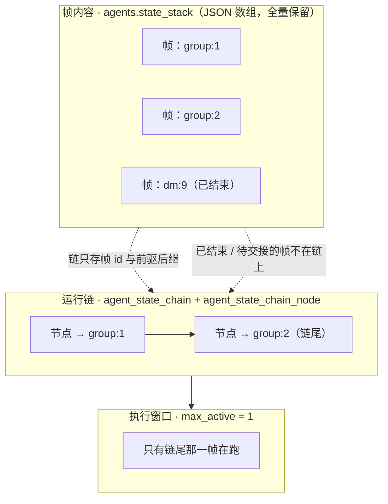
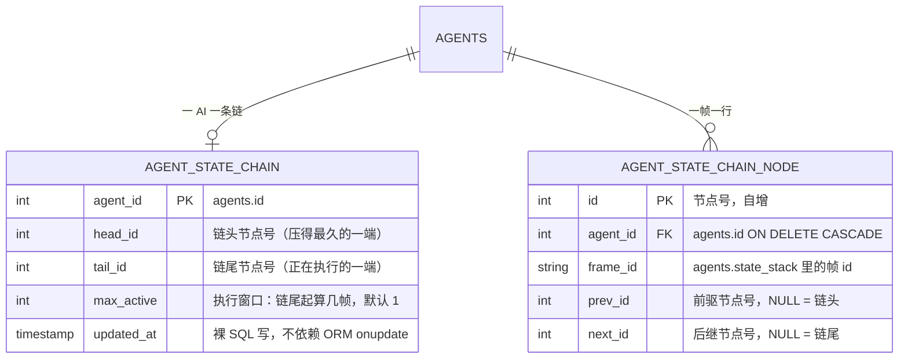
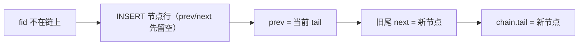
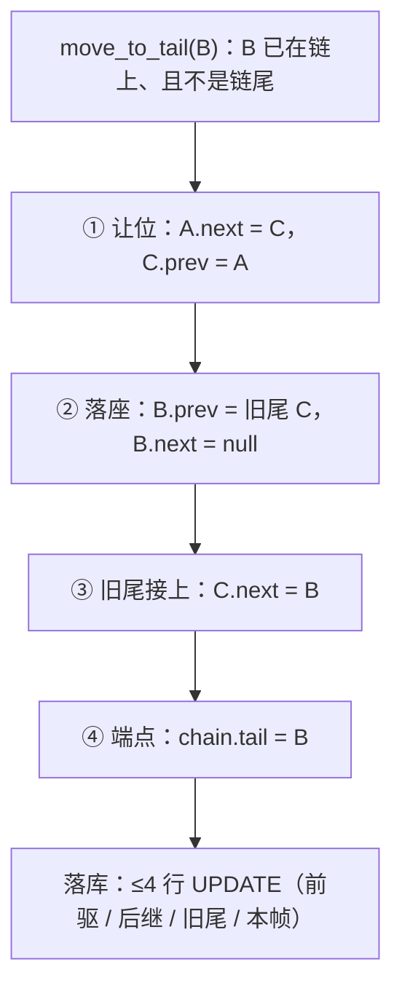
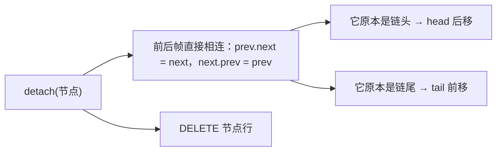
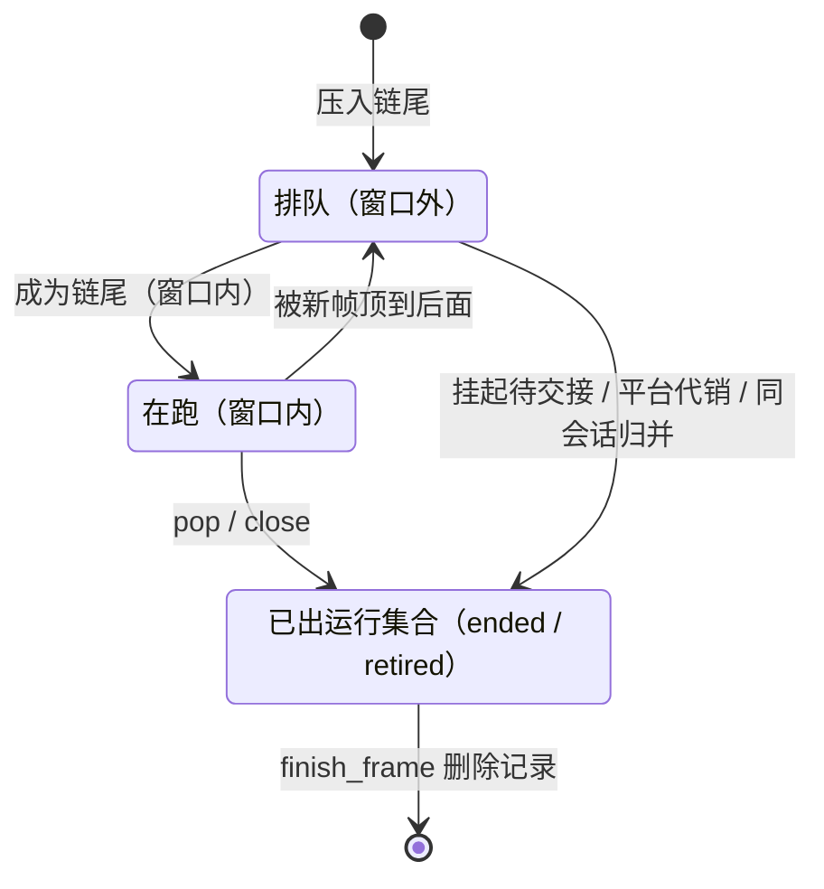
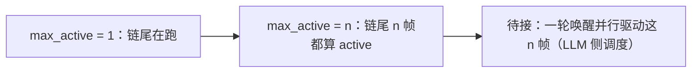
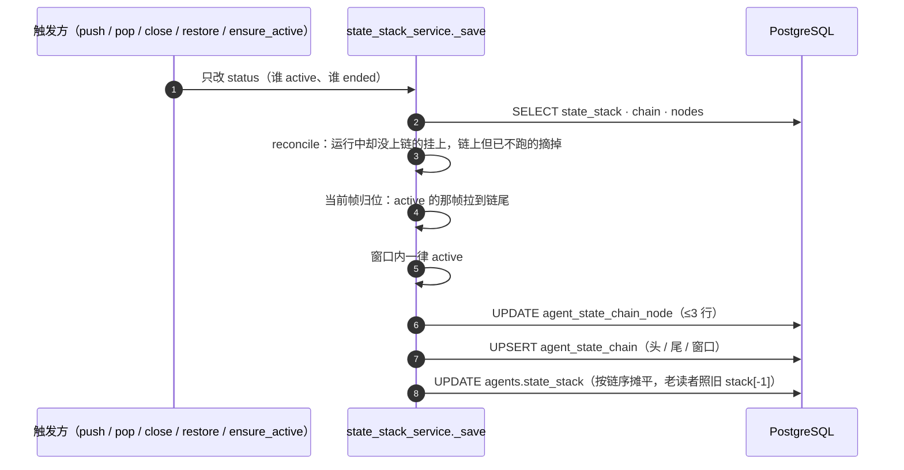
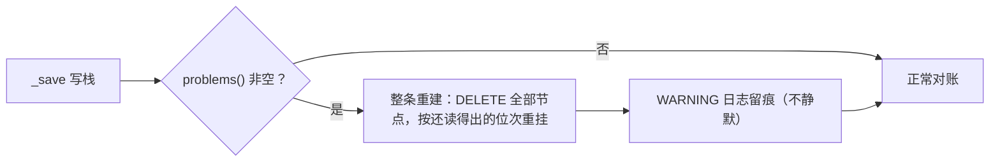

# 状态链：运行集合是一条双向链表

> **单一来源**：状态帧「谁在跑、接下来跑谁」只在这里维护。
> 帧怎么存、容量闸、同会话归并见[帧、锁与重建点](./frame_lifecycle.md)。
> 一句话分工：**帧回答「我在干什么」，链回答「先跑谁」**。

## 1. 要解决的问题

改造前「谁是当前帧」是**推**出来的：数组顺序 = `[历史区][运行区，当前帧在末尾]`，由 `status` 决定。
三个代价，量级是线上实测的：

| 症状 | 改造前 | 改造后 |
|---|---|---|
| 切一次会话 | 重排整份栈（最大的一份 126 帧 / 546 KB） | **≤4 行指针更新**，与链长无关 |
| 帧 id → 队列位次 | O(n) 扫数组 | 唯一键 `(agent_id, frame_id)`，**O(1)** |
| 「当前帧 + 整条队列」 | 读整份数组再找 active（5.4 ms） | 读两张小表（**0.75 ms**） |

同时保留 LIFO 的语义不变：**只执行链尾**（最后加入的那一帧）。

## 2. 三层，各管一件事

**节点不复制帧内容**：帧随时在改（doing / todo / 情感 / 调用计数），链只关心谁排在谁后面——
两层各写各的，谁也不会因为对方一改就作废。

## 3. 表结构

索引与约束（迁移 `0094`）：

- `UNIQUE(agent_id, frame_id)` —— 就是「帧 id → 链节点」的 O(1) 索引，也是「一帧不可能挂两个节点」的硬约束；
- `(agent_id, prev_id)` / `(agent_id, next_id)` —— 反向找邻居；
- `head_id` / `tail_id` **不设外键**：节点会随帧出运行集合被删，外键会把「删节点」和「改链」绑成一件事，
  反而更容易写出「删了行、链还指着」的半吊子。完整性交给对账。

## 4. 指针算法

三个算子全部是**常数条**指针更新，实现在 `backend/app/utils/pure/state_chain.py`，
每个算子都只返回「要落库的补丁」（`[{id, prev, next}]`），存储层照着 UPDATE 对应行——
**链表怎么连只有这一处写法**。

### 4.1 新帧上链：attach_tail

### 4.2 切回某帧：move_to_tail（"只执行最末位"的落地）

已经在链尾就是幂等空操作（一条补丁都不出）。原位置在链头也走同一段逻辑，头指针自动后移。

### 4.3 帧出运行集合：detach

## 5. 执行窗口

**窗口 = 链尾起 `max_active` 个节点**，尾在前。默认 1 ⇒ 只跑链尾那一帧，与改造前完全一致。

调大窗口就是改一列（`set_chain_max_active`）：窗口内所有帧一律 `active`，不必动任何帧记录。
**但一轮唤醒目前仍只驱动链尾那一帧**——真正的并行执行是运行时要接的活，不是链要接的活：

## 6. 谁维护链：一个写入点

`push_state` / `pop_state` / `close_state` / `restore_frame` / `ensure_active_frame`
**都只改帧的 `status`，一行不动链**。链由 `_save`（帧的唯一写入点）里的对账统一维护：

这条纪律的收益：任何新加的切帧路径都**不会**因为忘了动链而把顺序搞乱。

## 7. 不变量与自愈

`problems()` 每次写栈体检一次，四条：

1. `head.prev` 与 `tail.next` 都是空；
2. 每个节点的 prev/next 双向一致；
3. 从链头顺走一遍能走完所有节点（无环、无断头）；
4. 一个帧只有一个节点（`index` 与 `nodes` 一一对应）。

触发条件只有一种：**并发写**（两个请求读到同一条尾，各自把 `尾.next` 指到自己）。
增量去修环和断头容易再拧一次，所以选择重建——帧一帧不丢，读不出位次的按数组顺序接在最后。

## 8. 实测

126 帧 / 774 KB 的一份栈（贴着线上最大那份）：

| 动作 | 耗时 | SQL 条数 |
|---|---|---|
| `get_chain`（当前帧 + 整条队列） | **0.75 ms** | 2 |
| `get_current_frame`（读整份数组找 active） | 5.38 ms | 1 |
| 一次 `_save`（位次没变） | 15.6 ms | 6，**链一条都没写** |
| 一次 `_save`（切会话） | 16.6 ms | 8，链只多 2 条 |

**诚实的那条边界**：排序与查询已经是常数条，但一次写栈的大头仍是把整份 `state_stack` 重写一遍
（15 ms 里占绝大部分）——那是存储层的代价，链没有、也不该替它付。真要降它，下一步是把帧从
「一个大 JSON」拆成「一帧一行」。

## 9. 代码坐标

| 位置 | 干什么 |
|---|---|
| `backend/app/utils/pure/state_chain.py` | 纯指针算术：`attach_tail` / `move_to_tail` / `detach` / `window` / `queue` / `reconcile` / `problems` / `order_by_chain`（无 IO、无 DB） |
| `backend/app/models/agent_state_chain.py` | `AgentStateChain`（一 AI 一条链）+ `AgentStateChainNode`（链节点） |
| `backend/app/services/agent/state_stack_service.py` | `_load_chain` / `_ensure_chain` / `_chain_attach` / `_chain_move_tail` / `_chain_detach` / `_rebuild_chain` / `_reconcile_chain` / `get_chain` / `set_chain_max_active` |
| `backend/alembic/versions/0094_agent_state_chain.py` | 建表（含唯一键与前后索引） |
| `backend/tests/test_state_chain.py` | 21 条：纯函数 + 服务集成（含坏链重建、老 AI 首建链、群解散旁路） |
| `backend/app/tools/self_management/list_states.py` | 把链交给 AI：每帧 `executing` 标记 + `queue`（尾在前）+ `max_active` |

## 10. 接手时先看这四条

1. **别在业务路径里直接动链**——改 `status` 就行，`_save` 会对账；
2. **别给帧加前后指针**——链节点只存 id 是有意的（帧改内容不会让链失效）；
3. **老 AI 没有链是常态**：`_ensure_chain` 会在它第一次写栈时按当时的运行集合现建，当前帧不变；
4. **改 `move_to_tail` 必须同步改 `problems()`**：一个是写法，一个是体检，两者说的必须是同一套不变量。
