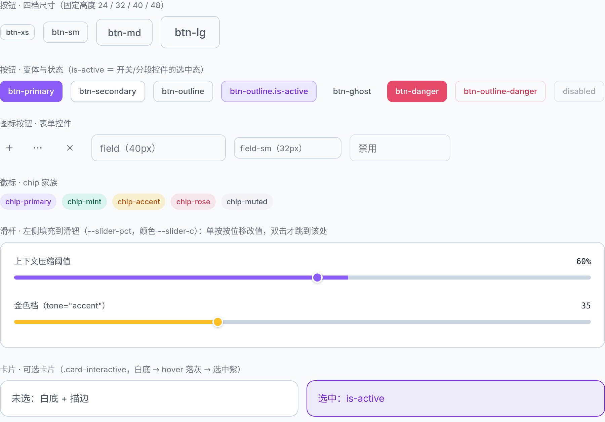
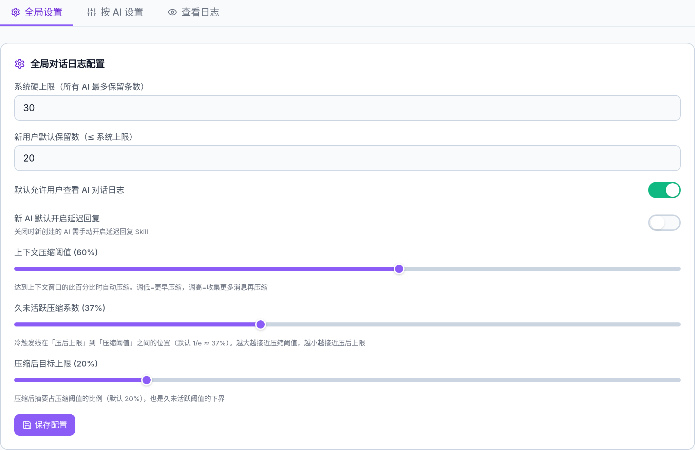

# 前端界面统一规范（单一来源）

> 版本：v1.1 · 更新：2026-10-04 · 适用：`frontend/`
>
> 目标：**改一处，全站生效**；新代码不用想样式，照抄下面的模式即可（"无脑"）。
> 全站视觉只有一个来源——`index.css` 里的语义类 + `tailwind.config.js` 里的尺度令牌；
> React 组件只是它们的壳。

---

## 1. 三层结构（记住这张图就够了）

```
tailwind.config.js      尺度令牌：圆角 / 字号 / 层级        ← 数值只在这里定义
        ↓
src/index.css          语义类：.btn .icon-btn .field .card .chip   ← 视觉规则只在这里写
        ↓
src/components/ui/     React 壳：PageShell PageHeader Button IconButton
                                 Input Select Card Badge Modal Dialog EmptyState
        ↓
页面 / 业务组件         只写布局（flex / grid / gap / 宽度），不写颜色、圆角、阴影
```

**判断标准**：如果一个页面里出现了 `bg-primary-500`、`rounded-2xl`、`px-3 py-1.5` 这类
"自己拼出来的控件外观"，它就是漏网的旧代码。

---

## 2. 尺度令牌（唯一的数值来源）

| 类别 | 令牌 | 值 | 用在哪 |
|------|------|----|--------|
| 圆角 | `rounded-control` | 8px | 输入框（大号/多行）、小卡片、列表项。**按钮不用它**——按钮一律胶囊 |
| | `rounded-card` | 12px | 卡片 / 面板 |
| | `rounded-dialog` | 16px | 弹窗 / 抽屉 |
| | `rounded-full` | 胶囊 | 徽标、头像、圆点 |
| 字号 | `text-3xs` | 10px | 徽标、脚注 |
| | `text-2xs` | 11px | 次级说明 |
| | `text-xs` | 12px | 辅助文字（Tailwind 默认） |
| | `text-sm` | 14px | 正文（Tailwind 默认） |
| 层级 | `z-overlay` | 30 | 页面内局部遮罩、拖拽把手 |
| | `z-drawer` | 40 | 侧边抽屉、移动端导航 |
| | `z-modal` | 50 | 弹窗 |
| | `z-toast` | 60 | 全局通知、嵌套弹窗、维护横幅 |
| | `z-max` | 100 | 阻断式提示（余额不足等） |

改全局观感 = 改这里一处。**不要再写 `rounded-xl` / `text-[10px]` / `z-[65]` 这种裸数值。**

---

## 3. 语义类（写标签时直接用）

下面这些类长什么样，看这张图（用真实 `index.css` 的类当场渲染，不是某个业务页面）：



### 按钮

```html
<!-- 实心主按钮 / 描边次级 / 危险 / 无底色 -->
<button class="btn btn-md btn-primary">保存</button>
<button class="btn btn-sm btn-outline">取消</button>
<button class="btn btn-md btn-danger">删除</button>
<button class="btn btn-xs btn-ghost">更多</button>
<!-- 开关 / 分段控件的选中态：同一颗描边按钮切状态 -->
<button class="btn btn-sm btn-outline is-active">按 AI 设置</button>
```

- 尺寸：`btn-xs`=24px · `btn-sm`=32px · `btn-md`=40px · `btn-lg`=48px（**固定高度，同行严格等高**）
- **尺寸按「容器等级」定，不按“重不重要”随手挑**（2026-11-22 定）：

  | 档位 | 出现在哪 |
  |------|----------|
  | `lg` 48 | 页面级最高主操作：登录/注册主按钮、首屏 CTA。少而醒目 |
  | `md` 40 | 页面头的主按钮、**弹窗底部**确认、40px 主输入（`field-lg`）旁的按钮 |
  | `sm` 32 | **卡片 / 面板内部的一切**：设置项、选项组、卡内主操作 |
  | `xs` 24 | 行内工具：表格行里的小动作、图标文字按钮 |

  卡片内的 `sm` 由 CSS 自动兜底（`.card .btn` 一刀切到 32px），页面**不用**写 `size="sm"`；
  判据是"它待在哪个容器里"，同一张卡里不允许出现两种高度。
  表单/设置卡的操作区统一用 `.form-actions`（右下角 + 间距），页面只写容器名。
- 变体：`btn-primary` / `btn-accent` / `btn-secondary` / `btn-outline` / `btn-ghost` / `btn-danger` / `btn-outline-danger` / `btn-tinted`（主色浅底）/ `btn-tinted-danger`（危险色浅底）——语义上要区分但不想实心时用它，别自己拼 `bg-primary-500/10 text-primary-400 border …`
- 选中态：`.btn-outline.is-active`（紫底淡化 + 紫描边 + 紫字）。开关、分段控件、勾选行都用它切状态，
  **不要**再写 `cond ? 'bg-primary-500/10 …' : 'bg-elevated …'` 这种两套配色——配色一改就得全站找一遍
- **有描边的次级按钮默认就是白底**（`.btn-secondary` / `.btn-outline`），hover 才落一档灰。
  `bg-elevated` 只留给"没有描边的安静底色"（标签、hover 态），别拿它当按钮/卡片底色：
  它比页面底色 `canvas` 还深一档，一整块会像下陷的灰补丁
- 布局类只加在需要的地方：`flex-1`、`w-full`、`shrink-0`、`mt-3`

### 图标按钮

```html
<button class="icon-btn icon-btn-sm" aria-label="返回">…</button>
```

尺寸：`icon-btn-sm`=28px · `icon-btn`=32px · `icon-btn-lg`=40px。
**图标按钮必须有 `aria-label`**（同时作为悬浮提示）。React 里用 `<IconButton label="…" icon={…} />`。

**同行等高**：同一 flex 行里的控件必须落在同一档。用 `ui/Select`（32px）配搜索/更多这类图标按钮时，
按钮**不要**写 `size="sm"`（28px）——差 4px 肉眼就能看出参差；默认档 `icon-btn` 才是 32px。
（2026-11-22 修 /list 排序行时踩过：下拉 32、按钮 28，一眼不齐。）

### 表单控件

```html
<input class="field" placeholder="用户名" />
<select class="field">…</select>
<textarea class="field" rows="3"></textarea>
<textarea class="field field-noresize" rows="3"></textarea>   <!-- 固定行数，不要右下角拖拽把手 -->
<input class="field field-sm" />   <!-- 32px 紧凑版 -->
```

- **一行里「输入框 + 按钮」**：输入框写 `field flex-1 min-w-0`，按钮用 `.btn .btn-md`（与 40px 控件等高），
  别用 `btn-xs` 贴在 40px 输入框旁边——高度不齐比没对齐更显眼
- 不要手写 `bg-elevated border border-border rounded-control px-3 py-2 text-sm`：那等于自己拼一个
  半径 12、38px、还可能与 `.bg-elevated` 的内描边叠成双边框的假输入框（2026-11-14 群设置页就是这套）

### 滑杆

```tsx
import { Slider, SliderField } from '../components/ui'

<Slider min={0} max={60} value={limit} onChange={setLimit} />
<Slider tone="accent" … />        // 金色档（滤镜那类，默认主色）
<SliderField label="Temperature" value={temp} setValue={setTemp} min={0} max={2} step={0.1} desc="…" />
```

- **样式只有一份**：`index.css` 里的 `input[type="range"]`（轨道 / 滑钮 / 左侧填充）。
  左侧填充的比例由组件写成 `--slider-pct`，颜色走 `--slider-c`；几何全由 `--slider-track` /
  `--slider-thumb` 推出来，别在 JSX 里写死像素（手写 `<input type="range">` 全站只该剩
  `components/ui/Slider.tsx` 一处，黑底浮层那种要另配轨道色的除外）
- **左侧填充**：轨道从左边画到滑钮，未填充段是描边色——一眼看出当前值在整段里的位置
- **拖拽按位移，不按位置**：按下**任何位置都不跳值**，只记起点，之后按沿轨道方向的位移量换值；
  垂直方向的位移一概不参与。原生 range 是"按下即跳"，手指偏一点就整段跳走（误触的来源）；
  **双击**才是"跳到这儿"，这是唯一会跳值的动作
- `touch-action: pan-y`：竖滑交给页面滚动，触屏上碰一下不会顺手改掉值
- 键盘（方向键 / Home / End / PageUp）仍走原生

### 卡片 / 徽标

```html
<section class="card card-pad">…</section>
<section class="card card-pad-lg">…</section>
<!-- 可选卡片（tile）：底色/描边/圆角仍走 .card，只补"可点"的反馈与选中态 -->
<button class="card card-interactive p-4">未选：白底 + 描边</button>
<button class="card card-interactive is-active p-4">选中：is-active</button>
<span class="chip chip-mint shrink-0">在线</span>
```

卡片底色是 `surface`（白）：容器底色 / 描边 / 圆角只有 `.card` 一处定义，别再自己拼
`bg-elevated border border-border rounded-card`——那是比页面底色更深的一层灰。

要让下面的内容透出来的浮层不走 `.card`，用 `.glass-float`（圆角 22 + 半透明 + 模糊 + 软投影）：
手机底部导航与聊天输入框共用这一份，别再各自抄 `rounded-[22px] border-black/[0.06] backdrop-blur-lg shadow-[…]`。

徽标色：`chip-primary` 紫 · `chip-mint` 绿 · `chip-accent` 琥珀 · `chip-rose` 危险 · `chip-muted` 中性。

悬浮说明（tooltip）全站只有一个实现：`HelpTip`（portal 到 body、量触发点定位、样式走 `MenuPanel`）。
不要用 `title` 属性（移动端不显示、长句被截成一行），也不要手写气泡——它挂在 `AutoHeight`
或对话框这类 `overflow-hidden` 的父级里会被裁成一条边。

- 说明类内容：`HelpTip` 内部已固定 `p-2.5 text-3xs leading-relaxed text-textSecondary`，调用方不要再传排版；
- 角标/图标上的说明（如已存 Key 的那把小钥匙 `KeyMark`）：`openOn="both"`（悬停 150ms + 点击）——
  鼠标停上去的人不会先点一下；
- 要能点的列表（选一项、跳一条）：`MenuPanel` + `MenuItem`，定位交给调用方，但同样必须 portal 到 body。
- 闸门：源码里出现 `role="tooltip"` 即红（`node scripts/check-ui.mjs`）。

---

## 4. 组件（写页面时优先用）

```tsx
import { PageShell, Button, IconButton, Input, Select, Card, Badge, Slider, SliderField, Modal, Dialog, EmptyState, ListPanel, ExpandPanel, confirmAsync } from '../components/ui'

// 页面骨架：根容器 + 标题栏 + 滚动 + 居中等宽，一次搞定
<PageShell
  title="群视界"
  subtitle="给群聊一个可编程的世界"
  onBack={() => navigate(-1)}
  width="content"                      // narrow | content | wide | full
  contentClassName="space-y-5"
  actions={<Button size="sm" icon={<Plus size={14} />} onClick={create}>创建</Button>}
>
  …
</PageShell>

// 按钮 / 图标按钮
<Button variant="primary" size="sm" loading={saving} onClick={save}>保存</Button>
<IconButton icon={<X size={16} />} label="关闭" onClick={close} />

// 弹窗：带标准卡片用 Modal，只有遮罩+自定义卡片用 Dialog
<Modal open={open} onClose={close} title="编辑资料" size="md" footer={<Button onClick={save}>保存</Button>}>…</Modal>
<Dialog onClose={close} className="flex items-center justify-center p-4">…</Dialog>

// 空状态 / 徽标 / 确认框
<EmptyState icon={Inbox} title="暂无内容" description="…" />
<Badge tone="mint">在线</Badge>
if (await confirmAsync({ title: '删除？', message: '不可恢复', danger: true })) …

// 「紧凑列表 + 详情按需出现」= 管理页的统一模式（插件页 / 命令白名单 / 技能背包）
<ListPanel
  title="命令白名单"
  columns={[{ key: 'pattern', label: '命令' }, { key: 'status', label: '状态' }]}
  toolbar={<><Input fieldSize="sm" value={q} onChange={…} /><Button size="sm">重扫</Button></>}
  empty={rows.length === 0 ? <EmptyState icon={Inbox} title="暂无内容" /> : undefined}
>
  <tr className="border-b border-border/50">
    <td className="py-2 px-3">…</td>
    <td className="py-2 px-3">…</td>
  </tr>
</ListPanel>

// 展开的那块详情：标题栏与「收起」由它统一给，内容自己写
<ExpandPanel title="QQ 通道" collapseLabel={t('tool:ui.collapse')} onCollapse={close}>
  …表单 / 实例列表…
</ExpandPanel>

// 语音播放：**全站唯一**的音频控件（VoiceMessage）。聊天里的语音消息、存储页点开
// 收藏的语音、预览弹窗，全都用它——不要另写 <audio controls>，浏览器原生控件是另一种长相。
// 波形是一根根细竖条：条数按时长算，高度取自频谱（播放时实时波动），静止时按文件身份
// 生成固定形状（同一个文件每次打开形状一致）。文稿默认两行，点一下展开全文、再点收起。
// 条的造型是定稿的，并绑定到尺寸档：每根 = 顶部小半圆 + 左边竖直 + 底部左半圆 + 右下尖角 +
// 右边外斜；圆角半径由条宽按比例给（large = 顶宽 × 0.32，inline = 半宽），别写固定像素值。
// inline（聊天）taper = 0，退化为规整圆角胶囊；large（弹窗）taper = 0.16，上窄下宽、圆角小而利落。
// 可调项只有两个常量：锥度 taper（0 = 完全竖直）与圆角比例 0.32。
<VoiceMessage
  fileId={att.file_id}                 // 附件走 fileId
  src={url}                            // 直链/世界文件走 src（二选一）
  size="large"                         // inline（聊天，240px）| large（弹窗，420px）
  transcript={transcript}              // 有就显示，没有只显示波形
/>
```

### 宽度档位（页面留白唯一来源）

| 档位 | 宽度 | 适合 |
|------|------|------|
| `narrow` | `max-w-xl` | 表单、发布页 |
| `content` | `max-w-3xl` | 单列内容（我的、用量、群视界列表） |
| `wide` | `max-w-4xl` | 卡片网格、表格（AI、商城、后台） |
| `full` | 不限 | 双栏页面（聊天、好友、设置、后台） |

内容内边距由 PageShell 统一给（`px-4 py-4 md:px-6 md:py-6`，移动端自动留导航栏高度）。

---

## 5. 常见模式（照抄）

| 场景 | 写法 |
|------|------|
| 页面 | `<PageShell title=… width=…>`，不要在页面里自己写 `h-full flex flex-col bg-canvas` |
| 页面顶端 | 用 PageHeader（PageShell 已含），不要手写 `h-14 border-b` 的 div |
| 弹窗 | Modal / Dialog，不要手写 `fixed inset-0` 遮罩（ESC、锁滚动、点遮罩关闭由 Dialog 统一给） |
| 按钮 | `<Button>` 或 `.btn .btn-md .btn-* ` |
| 开关 / 分段控件的选中态 | 同一颗 `.btn .btn-sm .btn-outline` 加 `is-active`，别写两套选中/未选配色 |
| 可选卡片（tile） | `.card .card-interactive`（选中加 `is-active`）；卡片底色一律走 `.card` |
| 拖动条 | `<Slider>` / `<SliderField>`，别在页面里手写 `<input type="range">` |
| 控制台（/admin） | 进 /admin 收起应用侧边栏（Layout 按路径判断），宽度全给管理界面；控制台自带可折叠导航栏（收起=只剩图标，`localStorage` 记状态）与顶端「返回应用」出口（和折叠按钮同一排）——侧边栏收起了就必须在这里留出口 |
| 控制台页签宽度 | 页签的宽度档位**只写在 `pages/console/workspaces.tsx`** 的 `width` 字段（表格/网格 `full`，表单 `wide`/`content` 居中），由 ConsolePage 统一套用 `PAGE_WIDTH`（定义在 `components/ui/PageShell.tsx`，全站仅此一份）；页签里不要再写 `max-w-*` 把内容钉在左边 |
| 宽屏多列 | 宽屏上靠"列"填满，不靠把一张卡拉长：一组设置用 `grid xl:grid-cols-2 gap-4` 成对排列（同排卡片自动等高，行才对得齐），特别高的卡片并排放一行、独占行的用 `xl:col-span-2`；卡片高低差太大时改用 `columns-1 xl:columns-2` 让两列自然配平（子项加 `break-inside-avoid mb-4`） |
| 管理面板导航 | 分组/顺序/图标/文案/组件/宽度**只写在 `pages/console/workspaces.tsx`**；分组按"管理对象"分桶（通用 / 用户与内容 / 能力与扩展 / 监控与日志 / 数据与维护），每桶 2~6 项、桶名要能盖住桶内所有条目。页面里不许再写第二份标签表（桌面端与移动端会漂移） |
| 图标按钮 | `<IconButton>` 或 `.icon-btn` |
| 输入框 | `<Input>` / `<Select>` 或 `.field` |
| 卡片 | `.card .card-pad` 或 `<Card>` |
| 徽标 | `<Badge tone=…>` 或 `.chip .chip-* ` |
| 悬浮玻璃面板 | `.glass-float`：圆角 22 + 半透明底 + 模糊 + 软投影，**只给浮在内容之上、要让下面透出来**的块用（手机底部导航、聊天输入框）。普通卡片仍走 `.card`——两者不是同一种东西，别再手拼 `rounded-[22px] backdrop-blur-*` 那一串 |
| 浮层让位 | 浮在内容上的块（输入区、底部导航）不占布局，就得由容器声明让位量 `--xxx-inset`，见下面「浮层让位」 |
| 通栏灯带（出血条） | 状态条/横幅要横向出血时：外层 `relative left-1/2 w-screen -translate-x-1/2` 撑到视口宽，滚动容器加 `overflow-x-hidden` 裁边（**不要**用 `overflow-x-auto`，会多出横向滚动条）；条里的文字必须再包一层 `width: var(--page-content-w)` + `mx-auto`，才能和内容列左对齐——否则字会跑到侧栏底下（2026-11-14 概览页踩过） |
| 顶部条 | `.top-bar`：**全站唯一**的顶部条外观——surface 底 + 一层普通的软阴影（不加发丝线、不用负扩散）。页面头（PageShell/PageHeader）、侧栏头、聊天头部、抽屉与弹窗头都挂它，别再写 `border-b border-border bg-surface`；高度统一 `h-14`。它自带 `position: relative; z-index: 10`——不抬层级时阴影会被下面不透明的卡片整段盖掉；吸顶的用 `top-bar-sticky`（不要再写裸 `sticky top-0`，会被上面那句 position 盖掉） |
| 胶囊按钮 | 按钮四档（xs/sm/md/lg）**一律胶囊**（2026-11-15 定）：动作是「一行可以点」，形状不随尺寸变、只有高度在变；md 以前是 8px 圆角，和同排的 sm 胶囊挨在一起「一个方一个圆」已统一。`.btn-pill` 冗余（仅兼容保留）；图标钮要圆用 `.icon-btn-pill`。**不要**在元素上补 `rounded-full`——工具类在本层规则之前，同权重会被 `.btn` 的圆角盖掉 |
| 浮起圆钮 | `.float-btn`：36px 圆形玻璃钮（"回到底部"），比 `.glass-float` 圆、小、投影浅；**挂在滚动区里**用 `absolute` 定位，挂到面板根上会把 `bottom-*` 算到输入区上 |
| 引用（回复某条） | `<QuotedMessage>`（`components/shared/`）：气泡里的引用与输入框上方的引用条**同一份实现**，顺序固定「竖线 → 名字 → 缩略图 → 文字」；竖线用 `self-stretch`（父级常是 `items-start`，`h-full` 撑不开）；`inverse` 切深底配色、`lines` 管行数、`prefix` 给输入框那侧加「回复 」 |
| 头像 | **只调 `utils/avatar.ts`**：`avatarGradient(senderType, hasAvatar)` 出类名、`avatarShadowColor(senderType)` 出投影色。自己 `primary-500→700`、他人 `primary-500→300`（`to-br`，深紫在左上）、系统 `rose-400→600`（`to-bl`）；有头像时末端色带 `/30`；首字字号走 `chatStyleClasses().textSize`，别在组件里另写一套 |
| 空状态 | `<EmptyState>`，不要自己拼居中提示 |
| 管理页列表 | `<ListPanel>`（表格壳 + 标题 + 工具条 + 空态）；行用 `border-b border-border/50`，单元格 `py-2 px-3` |
| 实体列表（插件/AI/应用） | **两行式**：上排「名称 + 类型 + 版本」，下排**一行截断的说明**（`truncate` + `title` 悬停看全文）。**完整说明与元信息（作者/来源）住详情，不住列表** —— 列表负责"认出它"，详情负责"讲清楚它" |
| 列表里的状态 | **圆点 + 文案**（颜色即语义），别只给彩色文字 |
| 列表里的启停 | **开关**（`<Toggle size="sm">`），不要用会变字的文字链接：位置固定、状态靠形态表达 |
| 列表里的详情 | **只读内容**用 `<ExpandPanel>` 就地展开（技能背包）；**带表单/凭据的配置**用右侧抽屉（`<Dialog layer="drawer" className="flex justify-end">` + `h-full w-full max-w-xl bg-surface border-l shadow-2xl overflow-y-auto`，见 `PluginDetailPanel`）——**先列表给状态与动作，详情按需展开** |
| 为什么不用弹窗/悬窗放配置 | 悬窗（popover）鼠标一移开就没了，装不下表单；弹窗遮全屏，看不清"我在改列表里的哪一个"。抽屉两头都避开：列表留在原地当上下文 |
| 设置卡的保存按钮 | **操作区统一在卡片右下角**（`flex justify-end mt-3`），按钮统一 `size="sm"`（32px）主色；不要跟输入框挤在同一行、不要用 md/40px。理由：一行里的输入框已经是 32px，旁边立一颗 40px 的按钮会把整行撑高、也让人分不清"保存的是这一格还是整张卡" |
| 确认框 | `confirmAsync()`，不要用 `window.confirm` |
| 危险色 | `rose`；成功/在线 `mint`；强调/通知 `accent`；品牌主色 `primary`（紫） |
| 主题色 | 一律走 `rgb(var(--tw-*))` 对应的 Tailwind 名（`bg-surface` / `text-textSecondary`…），
不要写死 `#fff` / `bg-gray-100`（深色主题会瞎） |

### 浮层让位

浮层（`.glass-float`）**不占布局**：消息从它下面滚过去，玻璃才透得出东西。代价是"内容会一直被浮层压住最后一段"，
所以浮层必须把自己的高度**声明给容器**，由三处各自读它：

| 谁 | 读什么 | 怎么读 |
|----|--------|--------|
| 滚动区的底部留白 | `--xxx-inset`（CSS 变量） | `.chat-scroll { padding-bottom: calc(var(--composer-inset, 7rem) + 0.75rem) }`——只有 CSS 能读变量 |
| 滚动条轨道底边 | `data-xxx-inset`（属性） | `MobileScrollbar` 读 `el.dataset.composerInset`；滚动回调里每帧读，读变量要 `getComputedStyle`（强制样式重算），读属性是纯 JS |
| 贴着浮层上沿的东西 | `--xxx-inset` 或同一个整数 | 例如"回到底部"按钮 `bottom: composerH + 16`、活动状态条 `bottomOffset`——**不要**写 `bottom-4`，那会落进输入框 |

规则：

- **一个数字、多种载体，值是量出来的**（`ResizeObserver` 量浮层高度 → 同时写变量与属性），不许在别处再硬编码一份。
- 变量名统一是 `--<浮层名>-inset`，属性名是它的驼峰版 `data-<浮层名>-inset`，两者必须成对出现（写一处就该想起另一处）。
- 现有实例：
  - 手机底部导航：`--mobile-nav-reserved` + `.pb-nav`
  - 聊天输入区（底部浮层）：`--composer-inset` + `data-composer-inset`
  - 聊天头部（顶部浮层，`shared/ChatHeader`）：`--header-inset`；它下面还压着「在沉浸式界面打开」
    那一条时，再用 `--header-strip` 追加一条的高度。滚动条不读变量，改成量 `[data-float="top"]` 的
    下沿（量一次 rect，不在滚动回调里读）
- 浮层自己挂 `z-10` 以上就是"在内容之上"；页面里别再给滚动区加 `pb-40` 之类的魔法留白去凑高度。

### 真实页面长什么样（控制台 → 对话日志）

共享下划线页签 + 白卡 + 三条带左侧填充的滑杆：



---

## 6. 新增一个视觉变体怎么做

1. 先想清楚它是不是已有变体的组合——八成是。
2. 需要新变体时，**只改 `index.css` 的 `@layer components`**（例如加 `.btn-tinted`），
   再在 `components/ui/Button.tsx` 的 `VARIANT_CLASS` 里登记名字。
3. 不要在页面里就地拼一套新外观；那样下一个人又得改一遍全站。

## 7. 自检（提交前跑一遍）

```bash
# 前端在容器里跑，容器内不装依赖
docker exec -w /app ai_group_frontend node_modules/.bin/tsc --noEmit
# i18n 四道闸门（等价于 npm run i18n:check）
docker exec -w /app ai_group_frontend node scripts/check-i18n.mjs
docker exec -w /app ai_group_frontend node scripts/check-i18n-keys.mjs
docker exec -w /app ai_group_frontend node scripts/check-i18n-parity.mjs
docker exec -w /app ai_group_frontend node scripts/check-i18n-hardcoded.mjs

# 别让旧的裸写法回流（数字应逐步下降，不应上升）
cd frontend/src
grep -rho "rounded-\(lg\|xl\|2xl\|md\)\b" --include=*.tsx . | wc -l
grep -rho "z-\[[0-9]*\]\|z-50\b" --include=*.tsx . | wc -l
grep -rho "text-\[1[0-9]px\]" --include=*.tsx . | wc -l

# 手写滑杆：只该剩 components/ui/Slider.tsx 一处（黑底浮层那类除外）
grep -rl 'type="range"' --include=*.tsx . | grep -v 'components/ui/Slider.tsx'

# 灰底卡片：数字应逐步降到 0
grep -rn 'bg-elevated' --include=*.tsx . | grep 'rounded-card' | wc -l
```

界面改完还要**截图对比**（`node scripts/screenshot/run.mjs`），别只靠类型检查。
本文档里那两张配图这样重出（输出到 `docs/assets/screenshots/ui/`）：

```bash
node scripts/screenshot/run.mjs --only ui-components,ui-convlog
```

## 8. 文案与 i18n

- 文案按命名空间分文件：`src/i18n/ns/<ns>.ts`，一个命名空间一个文件，三语（zh/en/ja）同序；
  新增命名空间不用改脚本，`check-i18n.mjs` 自动发现。
- 调用点写 `t('<ns>:<key>')`。**没有冒号就按 `common` 命名空间查**——所以拆命名空间之前的点号写法
  （`i18nKey: 'settings.chinese'`）在新结构下必然取不到，`t()` 查不到就把传入的 path 原样回显，
  界面上看到的就是 key 本身。最容易漏的是"藏在数据表里的 key"：`i18nKey / labelKey / keyLabel / descKey / hintKey`。
- **同一句话只留一个 key**：字段里别写裸文案（`labelKey: 'UI 缩放'` 等于没翻译）；页面标题优先复用导航的
  key（`nav:worlds`），别再造一个「群视界」。
- **提示的语气不要从文案里猜**。`msg.includes('失败')` 换语言就失灵——英文 "failed"、日文「失敗」都
  匹配不上中文关键词，红色提示会变绿。语气在产生提示的那一刻就是确定的（try/catch 走哪一支），
  用 `src/hooks/useNotice.ts`：`ok()/fail()/clear()` + `NOTICE_TEXT_CLASS` / `NOTICE_BOX_CLASS`，配色也只在那里定义。

四道闸门（`npm run i18n:check` 一次跑完，CI 阻断）：

| 闸门 | 抓什么 |
| --- | --- |
| `scripts/check-i18n.mjs` | 静态字面量：用了但字典里没有、字典文件没在 `translations.ts` 登记（漏登记＝整段裸 key） |
| `scripts/check-i18n-keys.mjs` | 拿**真字典**（esbuild 就地转译 `ns/*.ts`）逐个解析调用点，含动态 key 的数据表；另抓点号旧形式、key 字段写成裸文案 |
| `scripts/check-i18n-parity.mjs` | **字典自身**：三语键集合不一致、同一键的占位符集合不一致（`{count}` / `{name}`）、空值。这类错没有调用点可循，只在某一种语言的界面上静默变形 |
| `scripts/check-i18n-hardcoded.mjs` | **反方向**：可见文案压根没走 `t()`。用 TypeScript AST 只审白名单位置（JSX 文本 + `title` / `placeholder` / `aria-label` 等属性），`className` / `href` / `data-*` 不审；语言无关文本自动放行；存量棘轮只减不增 |

字典解析只有一处：`scripts/lib/i18n-dicts.mjs`（esbuild 转译后真 import），前三道共用。
三语本来就不该一致的情况（例如文案在示范 `{变量名}` 这种格式）在 `check-i18n-parity.mjs` 的
`EXEMPT` 里登记理由；登记了却不再命中会报「过期例外」，逼你回来删。

第四道是反方向：前三道都从「源码里用了什么 key」出发，看不见「可见文案压根没写 `t()`」。
判据只有一条——**这段文字会不会被非中文用户看到并需要理解**：会，就必须走 i18n；不会（`UTF-8`、
`worlds/`、`yyyy-MM-dd`），由 `scripts/lib/i18n-hardcoded-policy.mjs` 的语言无关判据自动放行，
不往字典里塞三份一样的文案。存量在 `frontend/i18n-hardcoded-baseline.json`，只减不增；
确属有意不翻的，在上一行写 `// i18n-exempt: 理由`，理由必填，登记了却没命中会报「过期豁免」。

## 9. 密钥 / Token 输入（SecretInput）

**不要把 Token 输入框写成 `type="password"`。** 浏览器会把 `type=password` 当成「账号密码」：
自动填入你保存的用户名/密码、提交后弹「是否保存密码」、框边冒出密码管理器的钥匙图标。
对一串 API Key 来说这三件事都是误导——用户会以为自己存的账号被填进去了。

统一用 `components/ui/SecretInput`：

```tsx
import { SecretInput } from '../components/ui'

<SecretInput
  value={token}
  onChange={(e) => setToken(e.target.value)}
  wrapperClassName="w-full"          // 布局类挂在包裹层：flex-1 / w-full
  placeholder={hasToken ? t('admin:tokenConfiguredPlaceholder') : ''}
/>
```

- 遮蔽是**纯视觉**的：始终 `type="text"`，靠 `-webkit-text-security: disc` 画点；
  只有极少数不支持该属性的浏览器才退回原生 `type=password`（同时关闭自动填充）。
- 自带 24px 圆形眼睛按钮（`.icon-btn-xs .icon-btn-pill`），不要在外面再手写一个切换按钮。
- 自带的 `autoComplete="off"` + `data-1p-ignore` / `data-lpignore` / `data-bwignore` 是给密码管理器的忽略标记，别删。
- 尺寸跟 `.field` 一致：默认 32px 胶囊；`fieldSize="lg"` 走 `.field-lg`（40px 圆角）。

**真·账号密码**（登录、管理员重置/创建用户）仍用原生 `type="password"`——这类场景浏览器的密码管理器是对的，
旁边加 `{/* ui-standard-ignore: 账号密码，浏览器密码管理器本来就该管 */}` 说明这是有意的。

闸门：`scripts/check-ui.mjs` 扫到 `type="password"` 且没有 `ui-standard-ignore` 就报错，
所以这条规矩不靠记性，靠 CI。

## 10. 左栏收起（四处同一套）

聊天列表、设置、DSH、控制台四处左栏都能收起，状态与动作只有一份：

- 状态：`hooks/useRailCollapsed`（localStorage 布尔，键各自独立：`chat_sidebar_collapsed` / `settings_sidebar_collapsed` / `dsh_sidebar_collapsed` / `admin_rail_collapsed`）
- 宽度：收起后 `RAIL_COLLAPSED_WIDTH`（52px）
- 图标：收起 `‹`（ChevronLeft），展开 `›`（ChevronRight）；只有 DSH 顶栏用 `☰`（Menu），避免和旁边的返回箭头混淆
- 聊天列表收起后是一列头像（复用 `GroupAvatarGroup` / `DmAvatar`，私信圆形、群聊圆角方块）；点收起时用 FLIP 把头像从列表位置平移过去——只动 transform，起点在视口外或系统开了「减少动态效果」时不做
- 分组：收起态按「置顶 / 群聊 / 私信」分段，线拉通整栏、线下一层竖向渐变淡出；这条线本身就是该组的折叠开关（展开态则是整行可点）
- 颜色一律沿用现有语义色（`bg-surface` / `border-border` / `hover:bg-elevated` / `primary-*`），不为收起态另造一套

## 11. 表情包的显示档位

插件在 `emoji.json` 里挑档，渲染层只认档名：

- `default_size`（整包）/ `size`（单张）：`s` / `m` / `l`，不写就是 `m`
- 只影响**输入框表情面板**（`s` 20px、`m` 56px、`l` 84px）；消息正文里发出去的表情尺寸不变
- 面板按表情包用 `UnderlineTabs` 分页——换的是「一屏表情」，属于切换视图

## 12. 表情在 AI 上下文里的样子

表情落库时会被拆成「正文 + 图片附件」，字节层面和随手发的一张图没有区别。为了 AI 读得懂，附件快照里带一份身份（`emoji.pack/id/name`），上下文层按它铺标记：

- 新消息的表情 → `[表情:名字]`（`multimodal.emoji_mark`；群聊/私信上下文与 `expand_message` 共用这一套）
- 普通图片 → `[图片]`；语音 → `[语音] 文稿`；其余 → `[文件] 名字（大小）`
- **不回溯**：已经进账本的旧消息不重写，仍旧是 `[图片]`（2026-11-22 定的口径）

名字要能被 AI 原样抄回正文（`[表情:名字]` 是入口认的写法），所以 `emoji_face` 会去掉名字里的 `[`/`]` 与换行、截到 24 字——往返不回来的名字等于没标。
