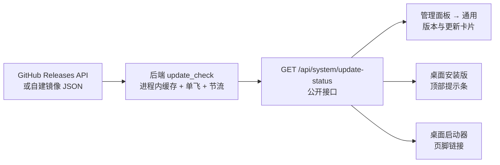
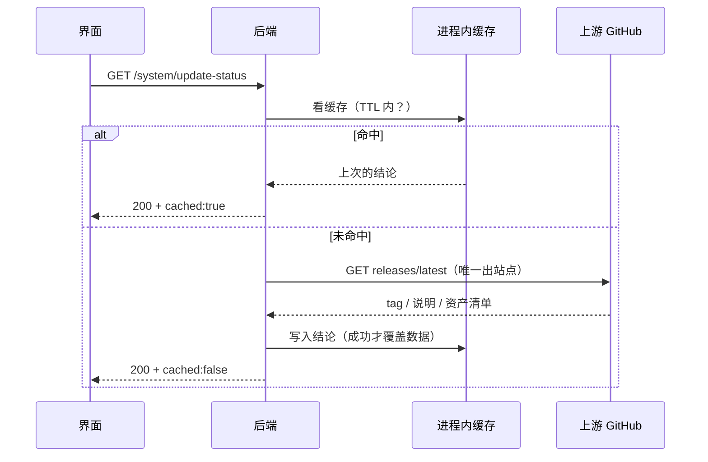
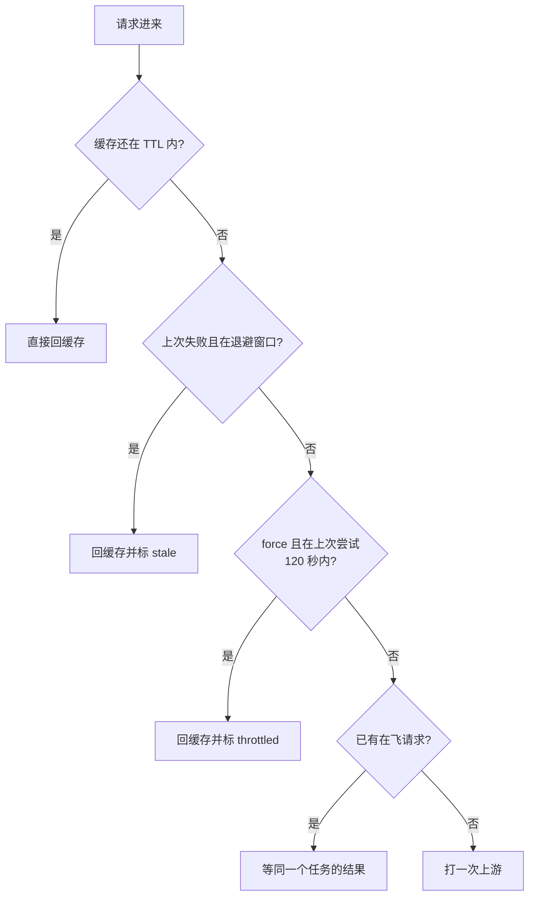
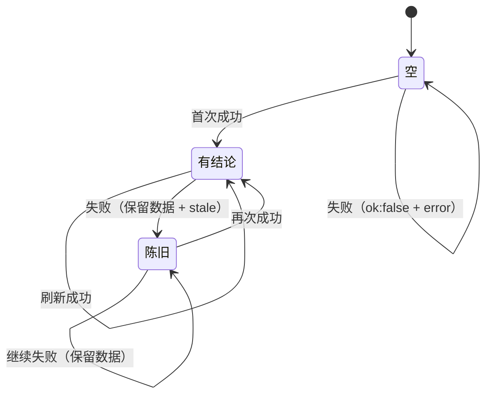

# 版本与更新检查

> **单一来源**：谁在什么时候问上游、结论怎么缓存、界面怎么展示、哪些地方绝对不能改。
> 改这里之前先读完「不变量」一节——每一条都对应一次线上事故或一次差点上线的问题。

## 它解决什么

装了哪个版本、官方最新是哪个版本，用户和管理员都不知道：

- **网页版（docker）**：`docker compose pull` 不会自己发生。部署后镜像停在拉取那一天，
  管理员要自己盯 GitHub releases 才知道有新镜像。
- **桌面安装版**：用户装完就再也不看发布页了。旧版有 bug 也只能等他自己想起来。
- **源码部署**：`git pull` 更不会自己发生。

所以结论只有一个：**服务端统一算出「本站版本 vs 官方最新版本」，三个界面各自展示**。



三个展示面共用一份结论；「谁更新」的判定只在后端一处实现，前端不重复算。

## 出站请求为什么只在服务端

浏览器/桌面壳直连 GitHub 的写法看着更简单，但失败方式很难看：

1. **境内网络访问 GitHub API 不稳**：同一个人可能这次看得到更新、下次看不到，
   排障时根本分不清是「没新版本」还是「没连上」。
2. **额度按客户端算**：未认证 GitHub API 是 60 次/小时/IP，每个客户端各打一次纯属浪费。
3. **桌面壳还得处理 TLS/代理**：后端已经有成熟的 httpx 出站，不必在壳里再造一套。



## 三层挡板

上游请求的三道闸，缺一道都会在真实部署里出事：



- **TTL（默认 3600 秒）**：正常状态下根本不出网，访问量再大也只每小时一次。
- **单飞**：「判断需要刷新」到「登记在飞任务」之间没有 await，同一事件循环里天然互斥，
  并发未命中只会产生一个上游请求（所以不用锁，也就没有「锁绑在旧事件循环上」这类坑）。
- **手动节流（120 秒）**：只有 force 受它管。狂点「立即检查」或写脚本刷，都换不来更多出站。

失败也会把 `attempted_at` 推到当下并挡满一个 TTL（退避）：离线/内网实例上，
否则每个页面加载都会去试一次、每次都可能卡到 6 秒超时。

## 失败时怎么降级

**失败只覆盖「最近一次尝试」，不覆盖「数据」**——已经知道有新版本这件事，
不能因为一次网络抖动就消失。



界面按三种情况显示：

| 接口返回 | 卡片 | 提示条 |
|---|---|---|
| `ok:true, has_update:true` | 有新版本 + 升级指引 | 出现 |
| `ok:true, has_update:false` | 已是最新 | 不出现 |
| `ok:false`（首次就失败） | 无法检查 + 分类原因 | 不出现（安静） |
| `ok:true, stale:true` | 上次成功的结果 + 一行「上游暂时不可达」 | 出现 |

## 渠道：stable 与 beta

默认的 `stable` **不只看 GitHub 的 `prerelease` 标记**，还要看版本号自己有没有预发布后缀。
理由是发布流水线（发布仓 `.github/workflows/build.yml`）建 Release 时只写 `draft: false`，
**不打 prerelease 标记**——如果哪天有人打了 `v0.5.0-beta.1`，只按标记过滤的话，
这个 beta 会被 `releases/latest` 当成正式版返回，于是所有人被提示「升级到 beta」。

| 渠道 | 收录 | 用途 |
|---|---|---|
| `stable`（默认） | 正式版；跳过 `draft`、跳过 `prerelease:true`、跳过版本号带后缀的 | 绝大多数部署 |
| `beta` | 正式版 + 预发布，取**版本号最高**的那条 | 内测机、发版前摸底 |

选择用 `select_release()`：**按版本号取最高**，不按发布日期取——热修可能后建、版本却更低，
「最新创建的」不等于「最新的」。

## 上游形状

`parse_release()` 归一化**单条**形状，`select_release()` 再处理「列表还是单条」，
自建发布渠道因此不用改代码：

| 归一化字段 | GitHub Releases | 自建镜像（简单形状） |
|---|---|---|
| 版本 | `tag_name` | `version` / `latest` |
| 发布页 | `html_url` | `url` |
| 说明 | `body` | `notes` |
| 时间 | `published_at` | `published_at` / `date` |
| 资产 | `assets[].browser_download_url` | `assets[].url` |

认不出（没有数字、`{"message":"Not Found"}`、数组、字符串）一律返回 `None`，
接口按 `bad_response` 处理——**不猜**。

默认地址取的是 `…/releases?per_page=20`（列表接口），这样一次请求就能同时看到正式版与预发布，
由 `select_release()` 按渠道挑；旧的 `…/releases/latest` 与镜像的单条 JSON 也照样能用（当成只有一条）。
上游通、但本渠道没有可用发布时（比如 stable 只看到预发布），`error` 是 `no_release` 而不是 `bad_response`。

## 三个展示面

| 面 | 出现条件 | 内容 |
|---|---|---|
| 管理面板「通用」卡片 | 所有发行版，管理员可见 | 当前/最新版本、状态徽章、检查时间、发布说明摘要；**按发行方式给升级方式**：docker 给 compose 命令（一键复制）、desktop 给安装包直链、source 给 git pull |
| 桌面版顶部提示条 | `distribution=desktop` 且当前用户是管理员 | 一行「Copree 有新版本 vX」+ 查看/关闭；关闭只对**这个版本**生效（localStorage 里带版本号），下个版本会重新提示 |
| 桌面启动器页脚 | 服务就绪后检查一次，之后每 6 小时复查一次 | 页脚左侧 `Copree v{当前}`（原来写死的 0.4.0 已删），右侧变成「新版本 vX · 点此下载」可点击；最小化到托盘时改发一条托盘气泡（同一版本只提醒一次） |

分工是刻意的：**网页版普通用户改不了服务器**，给他们看升级提示只是噪音；
桌面安装版的使用者自己就是管理员，所以在主界面里提醒。

## 配置

| 环境变量 | 默认 | 说明 |
|---|---|---|
| `UPDATE_CHECK_ENABLED` | `true` | 关掉后接口返回 `error:"disabled"`，界面显示「已关闭更新检查」，不报错 |
| `UPDATE_CHECK_URL` | GitHub Releases API | 任意返回 JSON 的地址（自建镜像） |
| `UPDATE_CHECK_CHANNEL` | `stable` | `stable` 只认正式版，`beta` 连预发布一起认；写错退回 stable |
| `UPDATE_CHECK_TTL_SECONDS` | `3600` | 缓存窗口；小于 60 按 60 算 |
| `UPDATE_CHECK_TIMEOUT_SECONDS` | `6.0` | 单次出站超时 |
| `APP_DISTRIBUTION` | `source` | `source` / `docker` / `desktop`；docker 由 compose 注入，desktop 由启动器注入 |

发行方式只影响**引导文案**，不影响任何功能。写错不会炸启动，退回 `source`。

## 代码地图

| 文件 | 职责 |
|---|---|
| `app/utils/pure/version.py` | 版本号解析与比较（纯函数）：`parse_version` / `compare_versions` / `is_newer` |
| `app/services/infrastructure/update_check.py` | 出站、缓存、单飞、节流、降级、`parse_release` / `select_release` / `pick_download` |
| `app/routers/system.py` | `GET /system/update-status`（公开）、`/health` 里带 `distribution` |
| `frontend/src/hooks/useUpdateStatus.ts` | 前端唯一取数入口（模块缓存 + 共享在飞请求） |
| `frontend/src/components/UpdateCard.tsx` | 管理面板卡片 |
| `frontend/src/components/UpdateBanner.tsx` | 桌面端提示条 |
| `gui_app/main.py`（发布仓） | 启动器页脚 |
| `backend/tests/test_version_compare.py` / `test_update_check.py` | 边界与缓存契约（不打网络） |

## 不变量（改之前先看）

1. **只回答「谁更新」，不回答「能不能直接升」**。跨大版本要不要先跑迁移是发布说明的事；
   写进比较函数会逼着前端理解迁移规则。
2. **认不出的版本号一律不提示**。上游一个畸形 tag 不该让全站弹「有新版本」。
3. **失败不清空已知道的结论**，只标 `stale`。
4. **前端不直连上游**，所有出站都在后端；新增展示面也只读本地接口。
5. **接口公开**：桌面启动器在登录之前就要显示提示，而 `/health` 一直是公开的，
   这里暴露的信息与之同级（当前版本 + 公开的最新版本）。防滥用靠缓存不靠鉴权。
6. **缓存是进程内的**：多 worker 部署每个进程各算一次。换来的是「不为一个展示性功能加一张表」；
   真要共享再加，别在缓存层塞 DB 调用。
7. **手动检查节流 120 秒**：`force` 只在窗口外才真的出网。
8. **stable 必须同时过滤「标记」和「版本号后缀」**：发布流水线不打 prerelease 标记，
   只按标记过滤等于没过滤（见「渠道」一节）。
9. **渠道写错一律退回 stable**：把测试版推给所有人是最坏的失败方式。

## 怎么验证

```bash
# 纯函数与缓存契约（不打网络）
docker exec -w /app -e TEST_DATABASE_URL=... ai_group_backend \
  python tests/run_without_pytest.py test_update_check

# 接口实况（cached=false 表示这次真的打了上游）
curl -s http://127.0.0.1:5228/system/update-status | python -m json.tool

# 手动检查的节流：紧接着再 force 一次应返回 throttled=true
curl -s 'http://127.0.0.1:5228/system/update-status?force=1' | python -m json.tool
```

想在没有新版本时验证「有新版本」那条路径：起一个本地静态目录，写一份上面「简单形状」的 JSON，
把 `UPDATE_CHECK_URL` 指过去即可。
