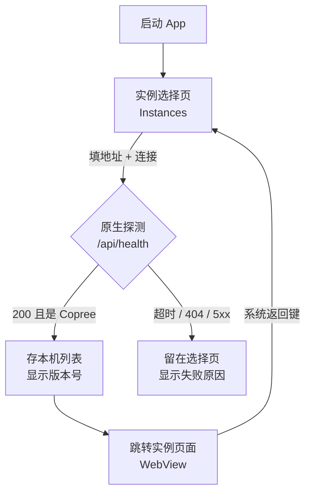

# 移动端客户端（Android） / Mobile Client

> **适用人群**：想在手机上用 Copree 的用户；打包装包、发布 APK 的维护者
> **最后更新**：2026-10-28

---

## 这是什么

Copree 有一个很薄的客户端：它自己不自带服务器地址，首次启动是一张「连接你的实例」的起始页，用户填自己（或朋友）的实例地址后，WebView 才切到那个实例上跑完整的 Copree 网页。

于是同一台手机上可以存多个实例：家里的、公司的、朋友的，随时点一张卡片切换，不用重装、也不用改配置。

| 项目 | 说明 |
|------|------|
| 包名 | `com.coprexist.aischatclient` |
| 形态 | Tauri 2 + Android WebView，界面即 Copree 网页 |
| 安装包 | 约 24.6 MB，含 `arm64-v8a` + `armeabi-v7a` |
| 系统要求 | Android 7.0（API 24）及以上 |
| 源码 | [Coprexist/Copree-Client](https://github.com/Coprexist/Copree-Client) |

客户端不是第二个 Copree：它没有后端、没有数据库、不缓存聊天内容。数据仍然全部在你自己实例的那套服务里，客户端只负责「找到它」和「显示它」。

---

## 安装与连接

### 1. 安装 APK

从项目的 Release 页下载 `aischat-<版本>-android-release.apk`，在手机上允许「安装未知来源应用」后安装。

> 如果拿不到 release 包，也可以自己构建，见下文 [自己构建](#自己构建)。

### 2. 填实例地址

首次启动不会连接任何服务器，只有一张表单：

- **实例地址**：`https://你的域名` 或局域网地址 `http://192.168.1.10:5227`。不写 `http(s)://` 会按 `https://` 补全。
- **名称（可选）**：只在本机显示，留空就显示域名。

点「连接」后，客户端会在原生侧请求实例的健康检查接口确认对方真的是 Copree（而不是一个恰好 200 的网页），拿到版本号后存进本机列表并跳转过去。



### 3. 多实例与切换

连接过的实例会变成卡片：名称、地址、上次使用的标记、实例当前版本号；右侧垃圾桶可以删除（会先问一次）。点卡片即切换。列表只存在手机的 WebView 本地存储里，不上传、不同步。

> 换手机、清数据后列表会丢，重新填一次地址即可，实例上的数据不受影响。

---

## 行为说明与已知限制

- **返回键**：实例页按返回键回到实例选择页，再按一次退到后台（不是杀进程）；从后台回来仍然是选择页。这是刻意设计的：跨域跳转后 WebView 的历史判定不可靠，客户端改成按「当前地址」判断。
- **允许明文 HTTP**：自建实例常以 `http://192.168.x.x:5227` 暴露，所以 release 包放开了 Android 的 Cleartext 限制。对外网暴露的实例仍建议走 HTTPS。
- **不做自动连接**：即使有「上次使用」的实例，启动也停在选择页——避免实例挂掉时卡在白屏。
- **iOS 未构建**：Tauri 的 iOS 目标需要 macOS 与 Xcode，目前没有对应产物。
- **调试只在 debug 包开启**：release 包不带 WebView 远程调试（见下节安全说明）。

---

## 自己构建

### 前置

- JDK 17、Android SDK（platform 36 + build-tools 36 + NDK 26.1.10909125）
- Rust（stable）与四个 Android target：`aarch64-linux-android`、`armv7-linux-androideabi`（真机）、`x86_64-linux-android`（模拟器，可选）
- Node 20+

```bash
export JAVA_HOME=/path/to/jdk-17
export ANDROID_HOME=/path/to/android-sdk
export NDK_HOME=$ANDROID_HOME/ndk/26.1.10909125

cd Copree-Client
yarn install
yarn tauri icon icons/icon.png          # 生成平台图标（src-tauri/icons 是生成物）
yarn tauri android build --apk -t aarch64 armv7
```

产物在 `src-tauri/gen/android/app/build/outputs/apk/universal/release/`，**未签名**。签名与对齐：

```bash
BT=$ANDROID_HOME/build-tools/36.0.0
$BT/zipalign -p -f 4 app-universal-release-unsigned.apk aligned.apk
$BT/apksigner sign --ks release.jks --ks-pass pass:<storepass> \
  --key-pass pass:<keypass> --out aischat.apk aligned.apk
$BT/apksigner verify --print-certs aischat.apk
```

### 版本号与 `versionCode`

`versionCode` 由 `tauri.conf.json` 的版本号推导（`0.1.0` → `1000`）。Android 的覆盖安装要求新包的 `versionCode` **大于等于**旧包，所以每次发布都要同时改版本号（CI 用 tag 名同步），不能只改代码。

### 签名：一条只走一次的规矩

**同一个应用只能用同一把 keystore 升级**：

- 本地自测包和 CI 发布包必须用同一把密钥，否则用户装新包时会被系统拒绝，只能卸载重装（本地数据随之清空）；
- CI 里没配密钥时会生成一次性密钥，产物名带 `-ci`，只能安装、不能覆盖升级，仅用于验证构建链路；
- 密钥泄漏比丢签名麻烦得多：`*.jks`、`keystore.properties` 已经在 `src-tauri/gen/android/.gitignore` 里，别提交。

### CI：GitHub Actions

`.github/workflows/android.yml`：

- `workflow_dispatch`：手动构建并把 APK 作为 artifact 上传；
- 推 `v*` 标签：构建、签名，并挂到对应的 GitHub Release。

签名材料放在仓库 Secrets：

| Secret | 内容 |
|--------|------|
| `ANDROID_KEYSTORE_BASE64` | keystore 的 base64（`base64 -w0 release.jks`） |
| `ANDROID_KEYSTORE_PASSWORD` | keystore 密码 |
| `ANDROID_KEY_ALIAS` | 密钥别名 |
| `ANDROID_KEY_PASSWORD` | 密钥密码 |

工作流只装 `aarch64` + `armv7` 两个 Rust target，并只构建这两个 ABI——x86 只有模拟器需要，编进去只是白白变大。

---

## 排障

| 现象 | 原因与处理 |
|------|-----------|
| 「连接超时：… 在 9 秒内没有响应」 | 地址不通（域名解析、端口、防火墙）或实例没起来 |
| 「… 上没有 Copree（/health 返回 404）」 | 地址填错，或填成了别的 Web 服务；反向代理要把 `/api/health` 或 `/health` 转给后端 |
| 「… 返回 502 / 503」 | 实例在启动中或数据库异常，看服务端日志 |
| 填了局域网地址却连不上 | 手机和实例不在同一网段；或实例只监听了 `127.0.0.1`，需要监听 `0.0.0.0` |
| 能连但页面白屏 | 实例前端资源没部署好；先用浏览器打开同一地址对照 |
| 装新包报「应用未安装」 | 两个包签名不一致（用了不同的 keystore），卸载旧包再装，或统一密钥 |

探测为什么放在原生侧：起始页和实例不同源，浏览器里发起的跨域请求会被实例的 CORS 策略挡掉（后端默认不注册 CORS 中间件），只有原生请求才拿得到真实状态码。

---

## 安全说明

- **不内置服务器地址**：代码和打包产物里没有官方实例域名，用户填什么就连什么；
- **CSP 收紧**：起始页只允许加载自身资源，只放行 Tauri 的 `ipc:`；
- **远程调试只在 debug 包开启**：`tauri` 的 `devtools` 特性没有写进依赖，release 包的 WebView 不能被 `adb` / chrome devtools 附加（可在包内 `.so` 中确认 `setWebContentsDebuggingEnabled` 字符串不存在）；
- **列表只在本机**：实例地址保存在 WebView 的本地存储，不随聊天内容上传。

---

## 相关文档

| 文档 | 说明 |
|------|------|
| [用户手册](./用户手册.md) | 网页端全部功能的操作指南 |
| [管理与开发者手册](./管理与开发者手册.md) | 部署、反向代理、更新与排错 |
| [版本与更新检查](../dev/update_check.md) | 实例版本号从哪来、客户端展示的版本标签怎么解读 |
